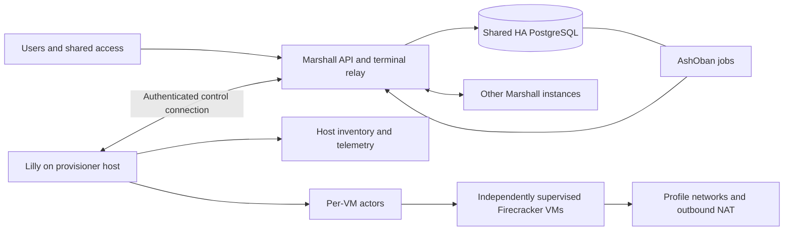

# Architecture

[ADR-0265](decisions/0265-rust-code-quality.md) gives every Rust crate one
canonical lint policy enforced by clippy gates and a drift checker, keeps
`lib.rs` files as module indexes, and makes Hegel the only Rust property engine.
Every crate has adopted it, and the checker refuses any crate that has not.

[ADR-0266](decisions/0266-anonymous-restored-guest-memory.md) makes restored
guest RAM an anonymous copy of the checkpoint memory file in the patched VMM, so
restored guests are charged to their VM cgroup like cold-booted ones.

[ADR-0264](decisions/0264-hermetic-mila-journey-fixture.md) verifies Mila's Rust
core against source-built Marshall and Porsche in a hermetic NixOS fixture. It
proves admission, authorization and ledger effects, but not guest execution,
the PTY, push delivery or device biometrics.

[ADR-0249](decisions/0249-mila-rust-core-native-clients.md) moves Mila toward
thin native clients over Rust. The separate `mila-session` crate composes pure
runtime projections with certificate-pinned SSH machine reads and pagination;
native adapter integration and full Flutter replacement remain partial, as
recorded in the [session review](reviews/2026-10-21-mila-native-session.md).

[ADR-0263](decisions/0263-retire-hldd.md) retires the authenticated HLDD handbook,
its review receipts and all HLDD gates, superseding ADR-0250. ADRs, architecture
reviews, contracts and native/machine tests remain the design record.

[ADR-0207](decisions/0207-bundled-multilingual-font-fallback.md) accepts bundled
Noto script fallbacks while retaining JetBrains Mono as the primary grid font.
It replaces only ADR-0161's exclusive-typeface clause; current packaged script
rendering remains a separate acceptance obligation.

[ADR-0220](decisions/0220-mila-client-over-porsche-ssh.md) through
[ADR-0228](decisions/0228-strict-host-certificates-in-mila.md) add Mila, the
Flutter client for iOS and Android (Linux for testing), which works only through
one Porsche SSH connection with per-deployment P-256 device keys and strict host
certificates. They also add canonical `overalls://` routes, the Porsche client
commands, terminal attach over a Marshall gateway stream, the Susan push relay at
`https://notifications.overalls.dev` and Marshall's Notifications domain with
end-to-end encrypted pokes. Susan runs on no fleet host. Marshall reaches it
only at the compiled origin, sending a canonical poke body that its install
identity signs. Status is in the
[M1](reviews/2026-10-18-mila-m1.md), [device](reviews/2026-10-18-mila-device.md),
[notifications](reviews/2026-10-18-mila-notifications.md),
[terminal attach](reviews/2026-10-19-mila-terminal-attach.md),
[Susan](reviews/2026-10-19-susan-push-relay.md) and
[M6](reviews/2026-10-19-mila-m6.md) reviews; all nine decisions are partial.

[ADR-0235](decisions/0235-mila-desktop-clients.md) extends Mila to macOS
(Secure Enclave, APNs, a shared Darwin notification extension) and Windows
(CNG keys in a TPM or the software provider, a DPAPI-sealed poke key, an
owner-only DACL and WNS), and gives every platform a dev and a release build
target. [ADR-0236](decisions/0236-susan-wns-provider.md) adds Susan's WNS
provider, whose egress is the compiled Entra ID origin plus channel URIs
confined to `*.notify.windows.com`. Both are partial; see the
[desktop review](reviews/2026-10-21-mila-desktop.md).

[ADR-0205](decisions/0205-overview-newsletter.md) accepts a durable account-wide Overview newsletter invitation and fixed server-side Ghost subscription path; implementation remains partial.

[ADR-0204](decisions/0204-git-attribution-and-guest-identity.md) preserves the reconciled duplicate Git attribution decision and its settings-page evidence; implementation remains partial.

[ADR-0203](decisions/0203-guest-reflection.md) accepts a secret-free, execution-fenced reflection projection over the private service path; implementation remains partial.

[ADR-0202](decisions/0202-github-com-owner-integration.md) accepts owner-bound GitHub OAuth custody and managed guest forwarding; implementation remains partial.
FreeBSD attribution-capable image `0150b6d1` now has all-five current-VMM
qualification, signed publication, fresh-store verification and additive source
admission/default selection. Immutable history and retained-native staging
preserve the old image's cold-restart authority without adding capabilities.
OmniOS selection, live fleet acceptance and native checkpoint support remain
separate; exact results and historical failures are in the
[GitHub review](reviews/2026-10-18-github-com-integration.md).

[ADR-0201](decisions/0201-localized-human-surfaces.md) accepts Localize-backed human surfaces with validated language preferences, LTR/RTL presentation and native Gettext catalogs partitioned by locale and feature. Public guides are localized; authenticated handbook chapters remain source English. Translation and native browser acceptance remain partial.

[ADR-0208](decisions/0208-windows-editor-job-custodian.md) replaces
[ADR-0200](decisions/0200-windows-browser-editor-candidate.md) with an independent
SYSTEM job custodian behind the native Windows editor's SYSTEM gateway broker.
The custodian owns atomic personal SAM/S4U worker launch, receipts and retained
kill-on-close jobs; both independently supervised roles validate their local
peer and current execution/release authority.
Its separate `windows-editor-v1` manifest-v7 and bundle-v4 candidate contract
requires the immutable editor tuple. The candidate remains outside the selected
production catalog; `windows-v1` keeps editor false. Implementation remains
partial. [ADR-0237](decisions/0237-windows-custodian-same-boot-recovery.md)
lets a restarted custodian retire an earlier generation's receipt only after the
worker's exact account logon session has no remaining process; native custodian
failure/recovery plus exact-image browser acceptance remain unrecorded.

[ADR-0199](decisions/0199-memory-suspension-and-demand-wake.md) accepts
memory-preserving suspension, paused relocation and demand wake with automatic
capacity relocation. New thread/Orb machines use a four-hour tool-idle policy;
owner pins wake and prevent automatic suspension. Checkpoints retain immutable
RAM backing independently of disk clones/backups, and authorized connections
wait through fenced restore or one fleet-gateway relay hop. Implementation and
native acceptance remain partial in the
[suspension review](reviews/2026-10-18-memory-suspension.md).

[ADR-0198](decisions/0198-git-attribution-and-guest-identity.md) defines account Git preferences, immutable new-machine Git identity and optional agent commit attribution.

[ADR-0188](decisions/0188-signed-overalls-cachix-substitution.md) adds the
signed Overalls Cachix read cache to all Nix-running hosts, installers and guest
images. The upstream cache and signature enforcement remain enabled, with local
build fallback; declaration evaluation is implemented while live cache rollout
remains partial.

[ADR-0189](decisions/0189-cachix-watch-store-publishing.md) enables continuous
signed-store publication from both fleet NixOS hosts using host-custodied SOPS
credentials; live upload acceptance remains partial.

[ADR-0178](decisions/0178-durable-agent-context-and-planning.md) adds durable
active context, compaction checkpoints and Plan/Work collaboration to the
Marshall-owned agent loop. Context is separate from retained transcript history;
questions, accepted answers and exact proposal implementation remain PostgreSQL
authority. [ADR-0179](decisions/0179-guest-instructions-and-managed-skills.md)
adds guest instruction collection and pinned public skill installation under
current thread authority. Guest context uses the existing fenced executor path,
and compaction uses the existing Ziggy pull/accounting path. No service or
listener is added. These are accepted decisions with implementation and native
verification pending in the
[context review](reviews/2026-10-16-agent-context-and-planning.md).

[ADR-0167](decisions/0167-native-guest-coding-clis.md) adds Codex and Claude Code
to both guest images with native Ziggy provider configuration and verified public
CA trust. Ubuntu retains their pinned, offline, registered and GC-rooted Nix
closure as an explicit application exception. These user-run clients keep
guest-local state and intentionally start with Codex danger-full-access/no
approvals and Claude bypassPermissions/no Bash sandbox; guest OS, VM, network
and Marshall boundaries remain separate from the clients' local policy.
The dangerous execution defaults are recorded in
[ADR-0168](decisions/0168-guest-coding-cli-dangerous-defaults.md), which
supersedes only ADR-0167's client-policy clauses.
Ziggy permits the exact native Anthropic `beta=true` query on Messages and token
counting; production Anthropic remains disabled. The
[review](reviews/2026-10-13-native-guest-coding-clis.md) distinguishes source,
fixture acceptance and deployment evidence.

[ADR-0169](decisions/0169-firmware-booted-windows-guests.md) proposes a third
guest family: Windows Server 2025 booted under Firecracker through edk2's CloudHv
UEFI firmware loaded as a PVH payload with the opt-in virtio-pci transport. The
pinned static Firecracker 1.16.1 carries nine reviewed patches (PVH RSDP
address, ACPI PM timer, Hyper-V CPUID leaves, PCI decode at reset, CMOS clock, BAR
relocation, virtio reset, scatter-gather block requests and, from ADR-0171, vsock
indirect descriptor tables) and keeps its version string. The image
is installed offline from Microsoft's hash-pinned evaluation ISO inside a KVM Nix
sandbox and described by a version-5 manifest.
[ADR-0170](decisions/0170-lilly-firmware-guest-launch.md) admits that manifest
and a version-2 firmware bundle, lets Lilly launch the image under the jailer
and network guard with the boot identity delivered through Firecracker's MMDS,
records such guests as running but `unattested` (never `guest_ready`), has the
image configure its `/32` from MMDS at boot, and has Marshall hide and refuse
terminals, agents, the editor and SSH for images without guest agents.
[ADR-0171](decisions/0171-windows-guest-agents.md) adds the `windows-v1` agent
set with a capability table both applications branch on, virtio-vsock through
the virtio-win `viosock` driver as the agent transport, Rust agents cross-built
for Windows from the Lyra crate, per-image standby eligibility and the
converged rollout that stages the image only after every host runs the new
code. Its agents are implemented: readiness, trust, roster SSH and host
certificates, the shared terminald under ConPTY, the workspace receiver with
winget's pinned Git for Windows and the shared agent executor; images are
Desktop Experience with pinned winget packages and WSL features (ADR-0173). The fleet proofs and the image
staging are pending. A separate Windows Code OSS runtime/source and broker
bring-up is staged with editor capability false; its native bundle, image
admission and browser acceptance remain outside this decision.

[ADR-0190](decisions/0190-native-kernel-provenance-and-admission.md) records the
cross-OS contract behind these detailed choices. Arch Linux and AlmaLinux retain
the version-4 Linux image shape with distinct deterministic markers. Native
FreeBSD and OmniOS use explicit version-6 manifests and version-3 bundles;
the illumos constructor records illumos.org as the upstream source project and
selects OmniOS as its pinned installable downstream;
protocol-owned artifact names, OS facts and kernel provenance prevent filename
inference and stock-kernel substitution. Lilly preserves the jailer, per-tap
guard, ZFS ownership and recovery boundaries, and requires a boot-bound native
kernel response before credentials or readiness. Unqualified native capability
rows remain all false. A separate exact-image registry and immutable promotion
paths activate only the reviewed FreeBSD and exact OmniOS images' readiness, trust, terminal,
workspace, flush, SSH and agent controls; editor and Inception remain false.
Retained stock images, altered identities and unreviewed OmniOS candidates
refuse new admission.
[ADR-0243](decisions/0243-native-guest-durability-verification.md) requires
flush receipts to survive host power loss and records native interrupted-growth,
power-cut replay and relocation evidence. The selected OmniOS fleet aliases now point to the exact
immutable promotion; candidate constructors retain their false admission flags.
A separate [cross-platform editor review](reviews/2026-10-18-cross-platform-editor-status.md)
keeps the editor capability Linux-only and records the missing current-revision
browser evidence; terminal, SSH and native service receipts do not widen it.
Stock-input kernel receipts contain no artifact bytes, so those constructors
refuse before copying a stock disk. The FreeBSD kernel candidate,
all twenty native Lyra executables and both terminal daemons cross-link in
pinned Nix builds. Native OmniOS assembly links all nine modules, installs the
full payload and exports cleanly; QEMU file/runtime checks and diagnostic
Firecracker executing-token/transport checks passed. Persistent console
configuration is installed; later source-qualified OmniOS receipts record two
complete service boots and separate growth and process-crash scenarios.
The scoped FreeBSD transport gate passed token/CID/refusal/credit-window checks.
Vendor-base FreeBSD candidates passed complete services and same-boot daemon
recovery over two clean boots. The later canonical-roots/SSH image passed
full service oracles with three-boot/two-expansion mounted-root growth and
separate two-boot IPv4/router/TAP policy checks. The policy sibling is a Linux
sink; direct native peer-VM/TAP, jail and physical isolation remain gaps.
The final reviewed FreeBSD image passed all five service, growth, policy,
daemon-recovery and same-disk SIGKILL/recovery variants with complete service
oracles and exact source-qualified receipts.

Mounted-root growth requires dual-GPT/capacity preflight and a fresh volatile
receipt before network/identity. The EFI oracle preserves exact file inventories
except bounded root firmware `NvVars`. OmniOS assembly disables vendor cloud-init
and SSH in the clone's offline SMF repository, and native trust keeps an immutable
vendor CA separate from the effective managed bundle. Actual FreeBSD crash
execution exposed scheduled-only UFS sync; native UFS suspension/resume corrected
the defect and passed the final scoped crash replay. Earlier OmniOS
process-crash receipts established neither policy nor qualification by
themselves. Wrong-CID injection, repeated/racing reset and DMA safety, physical
recovery and fleet acceptance remain separate gaps.
Earlier OmniOS diagnostics reached console login with growth in maintenance and
withheld kernel/service authority. The later corrected source-qualified growth
receipt records three clean boots and two expansions. These passing scoped
receipts preserved the earlier failed histories while supervised daemon
recovery and image qualification were still open at that point. The later
handshake-fixed image separately passed manual direct host-KVM transport,
reset, Lilly-policy, services, growth and process-crash runners, while its
daemon-recovery attempt failed. The final SMF/listener-corrected `45983bb7`
image passed all five required direct host-KVM scenarios, ordinary transport
and one reset event. Its exact immutable promotion and dual-family registry
qualification passed; formal nested-NixOS gates remain separate. The later
Nix-assembled `a96f291b` disk passed all five scenarios as Nix machine checks
and is now selected, with `45983bb7` retained in reviewed history.
The
[OS matrix](../guests/os-matrix.md) distinguishes the seven declared families
from the seven source-selected catalog rows and their execution evidence.
The [native review](reviews/2026-10-17-native-kernel-attestation.md) records exact
source-qualified artifacts and results. The
[activation review](reviews/2026-10-17-native-image-admission.md) separates the
reviewed FreeBSD promotion from broader physical and fleet acceptance. The
[matrix review](reviews/2026-10-18-guest-os-matrix.md) records the exact OmniOS
promotion and selected catalog aliases, healthy selected-release deployment and
one exact-image ordinary OmniOS CLI lifecycle, including terminal deleted
cleanup. The retained failed release-label probe and broader native/physical
acceptance gaps keep their separate scope.

[ADR-0149](decisions/0149-independent-observability.md) separates control and
observability: Lilly v4 carries capacity and physical readiness receipts, Ziggy v2
carries accounting, and service diagnostics go to independent OpenTelemetry
custody. Grafana dashboards are provisioned by NixOS. Historical evidence below
retains its original revision; it does not establish this cutover deployment.

[ADR-0153](decisions/0153-official-source-browser-editor.md) introduces a personal
browser editor built from pinned official Microsoft Code OSS source plus a
maintained patch stack. Marshall's Editor domain holds one-use approvals,
host/account cookies and renewable current-authority leases. Audi handles account
origins and immutable webview assets; Lilly opens the dedicated fenced port to a
guest broker, which starts each editor under its reconciled GuestAccount UID.
NixOS and Ubuntu declare the exact editor closure and manifest capability.
The [foreign Linux repair](reviews/2026-10-18-foreign-linux-browser-editor.md)
adds the missing package pair, broker service and descriptor to Arch/Alma.
Alma passed all twelve isolated native browser subtests, and both rebuilt
production images passed fresh strict CLI lifecycles. Arch's captured same-image
diagnostic replay passed all twelve browser stages; its earlier broker-recovery
502 remains unexplained and the later trunk merge is a separate source scope. Their earlier
seven-family milestone and retained disks keep their original image identities.
The guest package disables built-in AI/Chat and workspace trust, includes four
verified immutable Open VSX defaults, and delegates language tools to project
environments. Policy, extension lock and adapters bind the release identity;
extension pin maintenance remains separate from official-source updates.
Customer permits only its exact owner's fixed editor path. Generic Customer web
remains refused. ADR-0094 toolset and ADR-0135 cache requirements are carried
forward unchanged. Historical official package, standalone native and complete NixOS
Marshall→Audi→Lilly→Firecracker acceptance passed. Ubuntu provisioned and reached
the expected editor origin, then failed initial workbench visibility; ADR-0153
remains partial. The corrected merged NixOS fleet also passed, including current
physical `guest_ready: true`, recovery and sign-out closure; corrected Ubuntu
reproduced the initial workbench failure. Historical pre-cutover records retain
their original scope. Compiled policy and 19 extension-maintenance checks passed;
the final specialized Nix package also passed installed Chromium startup, while
the full merged Marshall gate passed. A fresh standalone run passed the original
cold browser journey and Alice's outside-HOME policy stage, then failed before
Bob's HOME command invocation. Both `058f13d8` guest-family fleet runs passed their
initial cold editor/terminal/custody subtest, then failed real-guest policy;
their new results remain separate from historical passing acceptance. Ordinary
user-overridable startup/walkthrough defaults subsequently passed a new package
build and separate fresh-profile browser smoke after workbench restoration;
saved-editor, extension-install and user override execution remain separate. Both hosts
settled healthy on `50021c04`, which contains this merge, without establishing a
production editor journey. Diagnostics stay in independent
Prometheus/Grafana.
The corrected startup-release frozen snapshot subsequently passed both complete
Firecracker fleet scripts: NixOS 805 seconds and Ubuntu 829 seconds, including policy,
personal controls, broker/worker recovery and saved-data restart. It predates the
later template changes and does not validate periodic sweeps. The final release
7d2415 package and matching guest image builds passed; complete standalone native
acceptance then passed in 342 seconds with personal version/reversion, core/System
refusals, actual Rust/Elixir, controls and broker/worker recovery. Initial failures
and old-package scratch results retain their scope. A strict scratch fixture passed
36 actual Workbench preference decisions and bounded forced-install filtering;
full UI/gallery and historical lower/equal scanner state remain separate. Both
hosts later activated exact 63a1443c/release 73ad, observed healthy
at 13:00 UTC on 2026-10-10 with matching new guest manifests. The separate current
13:06 existence-only check confirmed recurring fixture files absent; production
browser acceptance and recurring history remain unestablished.
ADR-0153 remains accepted/partial; the review retains all prior failed scopes.
Exact snapshot, host activation and separate production/recurring-probe gaps are in the
[editor review](reviews/2026-10-10-browser-editor.md).

The continuing-boot correction under ADR-0113/ADR-0133 preserves physical boot
identity while adopting a newer logical generation. Metadata histories, native
repeated-start continuity and the full Lilly component gate passed. Clone retry
and cancellation accounting and the full native clone matrix passed. Native
foreign boot refusal and relocation retry/cancellation accounting remain open.

ADR-0136's native DNS admitted-request producer-loss check passed: durable
pre-deadline settlement, completed-history continuity and fresh query recovery.
Other application in-flight faults and overload/storage acceptance remain open.

[ADR-0139](decisions/0139-private-slo-burn-delivery.md) adds optional private
Alertmanager notification delivery for the exact provisional burn roster.
Production enablement awaits an approved runtime destination and credential.

[ADR-0138](decisions/0138-telemetry-retention-and-measurement-diagnostics.md) adds
ninety-day metric/trace retention, shared measurement diagnostics and Underclass
duration buckets through twenty-four hours. ADR-0159 replaced its additive histogram
with one fifteen-bound histogram in a fresh journal. Objectives still evaluate
seven days; actual history and trace capacity remain observed acceptance limits.

[ADR-0137](decisions/0137-public-authenticated-grafana.md) adds opt-in authenticated
Grafana HTTPS at `https://ghuntley.dev:3443/` using the existing proxy and certificate.
The backend stays on loopback; production activation is tracked in its
[review](reviews/2026-10-03-public-grafana.md).

[ADR-0133](decisions/0133-durable-physical-service-level-accounting.md) adds
durable measurement admissions and numeric totals for creation-to-ready,
physical lifecycle and operation-linked SSH completion. These measurements do
not change execution or receipt authority. Packaged publication has native
evidence; both hosts activated `3f7ebc11` with healthy updater state. Native NixOS
agent and complete NixOS/Ubuntu Porsche acceptance passed. Earlier failures retain
their separate scope. Passive checks verified all 25 retained boots;
readiness activated healthy on both hosts, with 22 current ready journals verified in the
[review](reviews/2026-10-02-durable-physical-slos.md).

The workflow extension adds four independent receipt-bound sources for clone,
relocation, destination retry and cancellation. Compute retains terminal
exclusions for cancelled or superseded original intents; retry success requires
matching physical execution and committed readiness. That workflow configuration
declared twenty objectives and forty burn evaluators. Both hosts activated
`6a0b3c32` healthy, preserving all three original source identities and lifetimes.
The final receipt-bound native clone/relocation journey passed; native
clone source-restoration retry measurement has scoped native receipt-replay
evidence. Relocation destination retry, cancellation measurements and seven-day
observation remain separate gaps.

[ADR-0136](decisions/0136-durable-application-request-accounting.md) extends
the eight in-memory request sources with a Rust admission/completion recorder.
Its accounting/checkpoint core, authenticated Rust runtime, independent Nix
supervision and a separate producer I/O library exist. All eight request hooks
are present. Native recorder/BEAM crash and clean-deployment fixtures have passing
evidence. Fleet bindings now declare eight independent recorders/exporters on
Overalls and five on Dungarees, with explicit measurement horizons. Both hosts
activated `b7e29b8f` healthy with zero updater failures, as recorded in the
[production inspection](reviews/2026-10-03-telemetry-retention-and-diagnostics.md).
Full per-source fault acceptance and external alert delivery remain separate
requirements. Protocol measurement types remain pure; ADR-0142 separately adds
the named outbound control WebSocket transport modules.

[HTTPS egress production acceptance](reviews/2026-10-02-https-egress-production.md)
passed ordinary NixOS/Ubuntu HTTPS, redirects, shallow Git clone, shared public
cache and protected/Customer refusals on Overalls before and after guest restart.
The same review records native HTTPS/ZFS recovery with the origin stopped and
retains a failed Ubuntu provisioning observation separately. This verifies
single-host paths under ADR-0069/0113, not independent-host or universal recovery.
Cleanup exposed an ADR-0112 inventory gap for mount namespaces retained only by
descriptors. Its native repair preserves fenced ownership and ordinary unmount;
the review separates native execution from deployed cleanup evidence.

[ADR-0131](decisions/0131-automatic-magic-link-sign-in.md) makes a browser
magic-link visit submit sign-in automatically, issue a remembered credential and
follow the existing return/MFA routing. The GET itself leaves the token intact.

Superseded [ADR-0132](decisions/0132-seven-day-provisional-fleet-objectives.md)
previously configured provisional seven-day objectives and warning burn states
initially for thirteen named paths, later expanded to twenty objectives and forty
burn evaluators. Its Marshall `/admin/slos` view read actual fast/slow evaluator
states with a fixed roster and freshness guard. ADR-0149 retires that application
reader and provisions current diagnostic views in Grafana; the objective roster
and missing-history guards remain in Prometheus. The historical
[retention and diagnostics review](reviews/2026-10-03-telemetry-retention-and-diagnostics.md)
records its captured configuration, native presentation checks and production
rule health. Seven-day eligibility, complete user journeys and external
notification delivery remain separate gaps; missing history remains unknown.
The current roster adds two editor browser sources under ADR-0153 for twenty-two
objectives and forty-four burn evaluators. Independent Prometheus/Grafana own
their diagnostics; direct NixOS helper acceptance and incomplete Ubuntu execution
are separate from recurring probe and retained-history acceptance.
ADR-0132 superseded [ADR-0129](decisions/0129-fleet-otel-slos.md),
which accepted fleet-hosted
OpenTelemetry SLOs with host-local collection, central metrics and trace stores
on Overalls, and a separate guest diagnostic path through Audi. Guest claims do
not determine outer-fleet SLO compliance. Brady now emits a private cumulative
candidate request SLI through a Rust host exporter and restricted collector Unix
socket. Galileo now records authorized integration outcomes and durations for a
separate Rust exporter and collector intake. Enrico now records terminal mirror
refresh outcomes through its own Rust exporter and collector intake. Porsche now
records eligible terminal SSH command dispatch outcomes through a private
snapshot and a fourth isolated Rust exporter. Ziggy now records durable
terminal inference completions with a fifth isolated Rust exporter. Audi private
now counts bound non-OTLP request transport completions with a
separate source-owned snapshot and Rust exporter.
Audi's public DNS role now produces a distinct candidate authoritative-answer
snapshot through its own Rust exporter and collector intake.
Audi's SSH gateway now produces a distinct candidate granted-session
establishment snapshot through a source-group-readable file, static Rust
exporter and SSH-only collector intake. Invalid and denied grants stay outside
its denominator; the provisional target is configured, while full source fault
acceptance and production seven-day history remain open.
Marshall now counts browser HTTP completions from its endpoint into a private
snapshot exported by Rust through a Marshall-only collector intake. Provisional
targets and burn evaluators are deployed; complete source fault
acceptance, eligible seven-day readings and notification delivery remain open.
Underclass has a separate Rust probe of its read-only local monitor socket on
each host. Its guarded Grafana candidate measures local monitor readiness.
Authorized proxy completion has a separate durable request SLO; live provider
reliability remains outside this local readiness measurement.
The source-local producer and pure aggregate model now live in the breaking-change
`elixir/request_accounting/` library. It centralizes durable admission custody,
bounded recorder I/O and value-model snapshot arithmetic while leaving
eligibility, classification, concurrent storage and publication with each
application. This remains independent from the best-effort diagnostics library.
The [Underclass proxy review](reviews/2026-10-02-underclass-proxy-slo.md)
tracks a Rust durable proxy completion source, independent exporter identity
and thirteenth provisional objective. The isolated native fixture and two-host
activation at `3ef521c5` were verified. This does not establish guest or tailnet reliability.

[ADR-0157](decisions/0157-multi-provider-authenticated-repository-launch.md)
replaces ADR-0128's GitHub-only/no-resume choices with source2 for GitHub, GitLab,
Codeberg and Bitbucket. Public `/launch/entry` captures bounded canonical input in
the existing signed cookie; current login and required MFA precede ordinary
Compute admission. Current manifest4 identity declares the actual source2 receiver
capability and optional editor release. Only the guest resolves and clones;
boot-bound delivery remains independent of running/readiness. Retained snapshots
and journals are not rewritten. [ADR-0156](decisions/0156-browser-launcher-distribution.md)
adds explicitly configured unsigned Chrome/Firefox packages, source-built by Nix
and served from public `/bin` routes, plus an exact-origin optional detector whose
presentation marker never grants authority. ADR-0156 remains partial until the
Chrome and Firefox setup-visibility runtime evidence is recorded; its immutable
packaging and launch checks are implemented. ADR-0157 is implemented after both
captured provider/revision journeys passed all twenty combinations, cross-tab
resume/MFA, retained restart, public downloads and packaged CLI. The
[launcher review](reviews/2026-10-10-browser-launcher.md) separates implementation
and executed scope from native, public-provider and production validation gaps.
Those captures precede ADR-0158 integration and do not establish the latest
combined source2/generated-identity source.

[ADR-0126](decisions/0126-bounded-database-client-recovery.md) tightens lost-client
database detection to one-second active polling and a 15-second TCP
unacknowledged-data limit. A captured native lock-convoy candidate passes the
existing recovery bound and a healthy 20-second query. Complete integrated NixOS
and Ubuntu terminal journeys also pass. Inherited disk, resize, capacity and deployment
decisions remain in force.

The [ADRs](decisions/README.md) hold decisions and rationale. This overview maps
the intended system to the current implementation. The
[completion audit](reviews/2026-09-16-plan-completion-audit.md) maps current
requirements to executed evidence and missing inputs. The
[baseline review](reviews/2026-09-15-governance-baseline.md) preserves the initial gaps.

## Current implementation

[Clone restart recovery](reviews/2026-09-26-clone-restart-recovery.md) preserves
retryable native storage contention and owned import staging before VMM launch
and adds bounded readiness
diagnostics. It retains the existing Ash state machines and cleanup authority;
deployment, recovery and renewed production acceptance are tracked in the review.

[Production clone/relocation acceptance on 2026-09-25](reviews/2026-09-25-production-clone-relocation.md)
passed fresh creation and guest access but found new copies and moves blocked by
an older clone's failed source restoration and retained Overalls transfer slot.
ADR-0055's cleanup authority remains intact; ADR-0092's bidirectional production
acceptance must be repeated after recovery.
[ADR-0130](decisions/0130-verified-provisioning-fastpath.md) records the approved
provisioning performance design. Shared stripped kernels, guarded Ash template
and boot-readiness journals, and a Rust/Hegel copy helper are implemented with
new producer options disabled by default. Real-ZFS template publication, independent
disk use, retirement, crash recovery and bounded catalog passed native tests.
The historical reader release was healthy on both enrolled hosts with `pool_id`
installed and producers disabled. Two one-off NixOS/Ubuntu authenticated SSH
canaries confirmed cleanup on that release. An early native NixOS Porsche
lifecycle fragment passed, but its combined fleet run failed later at the terminal stage.
The Ubuntu SSH journey passed login, revocation, renewal, relocation, reboot
and clone in a fixture enabling both producers; native template use, readiness
journal assertions and production activation are still distinct.
The first controlled readers-off campaign produced exploratory sequential
medians but failed two concurrent creates; cleanup was independently confirmed.
That campaign's later read-only preflight refused a cross-host Ubuntu image-ID mismatch
from non-reproducible guest Nix registration DB bytes; a sandboxed builder
normalization was added without accepting cross-host rebuilt artifacts in that
preflight. The later captured watcher NixOS lifecycle passes as recorded under
[ADR-0149](decisions/0149-independent-observability.md), before the incoming
Starship guests and retained-state profile migration.

Current [Dungarees](../../fleet/hosts/dungarees/configuration.nix) and
[Overalls](../../fleet/roles/control-plane/services.nix) declarations enable templates
with a 32 GiB per-pool budget, 128 standby disks per image and same-pool block-copy
clones. Incoming `e3300040` reports rollout and sampled NixOS creates of
10.8–15.1 seconds; those author-reported observations are distinct from this
change's captured native tests and independent live acceptance. Native state-only
journals and capacity accounting remain required; ADR-0149 retires the old
diagnostic-wire readers. [ADR-0145](decisions/0145-same-pool-block-cloned-clones.md)
remains accepted/partial and [ADR-0146](decisions/0146-standby-guest-disks.md)
is now accepted/partial following the user acceptance recorded in `e7e2f2e3`.
Complete current NixOS/Ubuntu and fault-matrix acceptance,
retained-state native upgrade and matched post-rollout performance remain
separate obligations. The [ledger](../history/ledgers/provisioning-fastpath.md) records each
result's scope.

[ADR-0152](decisions/0152-lean-pool-locked-preparation.md) (accepted/partial)
makes each pool-locked disk preparation read native state once, as one
`PoolSnapshot`, and re-verify the pool once after its own mutation. Native
traces halve the whole-pool listings per standby claim with every refusal kept;
the production concurrency campaign remains outstanding.
[ADR-0274](decisions/0274-fenced-capacity-snapshots.md) (accepted/partial)
reads capacity snapshots outside the pool lock, fenced by a generation token
that every pool section replaces, so mutations no longer wait for them.

[ADR-0143](decisions/0143-faster-create-clone-delete.md) addresses measured
create, clone and delete latency. Image materialization adds kernel copy offload
after `FICLONE`, because the image store and VM datasets are on separate mounts
of one pool. Clone and relocation exports send compressed streams, and same-host
clones use a separate local rate. Deletion fences on dataset identity instead of
whole-pool usage equality and reports a fixed failure stage. Unit and property
evidence exists; native ZFS evidence and post-deploy measurement are pending.

[ADR-0144](decisions/0144-nix-builds-exclude-guest-datasets.md) runs `nix-daemon`
in a private mount namespace without Lilly pools: user-namespace Nix sandboxes
otherwise hold locked guest dataset copies that stall fenced deletion until the
build exits.

[ADR-0120](decisions/0120-ssh-onboarding-guidance.md) adds bounded SSH setup
guidance, shared active-key recognition and explicit diagnostic channel states.
Validation and rollout gaps are tracked in the
[review](reviews/2026-09-25-ssh-onboarding-guidance.md).
[ADR-0122](decisions/0122-hldd-section-pages.md) replaces the single-page
handbook with `/hldd` contents and individual authenticated section pages. It
retains shared navigation, diagrams, generated NixOS option reference, and a
mandatory source-review gate. User scenarios explicitly record layered security
boundaries, preferred NixOS/property evidence and testing gaps. Validation is
tracked in the [section review](reviews/2026-09-25-hldd-sections.md).
Mandatory [Ash and topology views](reviews/2026-09-25-hldd-views.md) added literal
domain/resource ownership and evaluated fleet placement. ADR-0263 later retired
the handbook, its views and its gates.

[ADR-0119](decisions/0119-authenticated-control-room-reads.md) opens the Control room
and its bounded redacted projections to all signed-in users. Administrative
mutations retain current administrator membership and passkey
elevation; VM, terminal and SSH permissions remain separate. The
[review](reviews/2026-09-25-control-room-read-access.md) tracks validation.

Superseded [ADR-0123](decisions/0123-remembered-browser-authority.md) carried those requirements
forward and connected persistent browser resume to independent MFA. Global browser
revocation includes remembered credentials; account row locks serialize token
exchange with revocation, reset and retirement. No guest or service authority changes.

[ADR-0160](decisions/0160-privileged-administrator-step-up.md) replaces the
inherited five-minute administrator step-up with a fixed fifteen-minute receipt
and inline continuation of the exact pending action for enrolled administrators.
An administrator without a passkey visits Security settings for fresh-email
credential setup, returns to the original page, and explicitly retries the action;
stale role, login, resource or substituted arguments refuse without a mutation.
Passkey credential changes retain verified-existing-key authority, and Cedar continues
to refuse foreign Customer resources even for elevated administrators. Its
[review](reviews/2026-10-11-privileged-administrator-step-up.md) separates this
accepted design from its socket-local implementation and recorded packaged browser
evidence. Native timed receipt expiry, target-page recovery, hardware authenticators
and production rollout retain separate acceptance gaps.

[ADR-0124](decisions/0124-unified-ssh-host-ca.md) replaces
[ADR-0118](decisions/0118-installer-management-ssh-trust.md)'s management fingerprint
with one dedicated SSH host CA for Porsche, Audi and fresh guest disks. The
installer obtains scoped CA trust through verified HTTPS and retains strict
account-proof SSH. Live Linux installer acceptance passed against fresh NixOS and
Ubuntu guests without authenticity prompts. Gateways retry unavailable initial
issuance every five seconds; native delayed-issuer recovery passed. The linked
review retains the initial deployment correction and exact verification scope.

[ADR-0158](decisions/0158-durable-guest-identities.md) gives each User UUID a
durable GuestAccount UUID, noncycling UID, immutable `u<uid>` Linux login and
`/home/u<uid>` home. Same-user email changes preserve that identity and editor
origin; retirement reserves it permanently and a fresh same-email User receives
another identity. Mailbox syntax is independent of Linux naming. No profile
username or onboarding is added. This is a breaking development cutover with no
retained-disk conversion or deployment; historical restore requires reservation
reconciliation. Its [review](reviews/2026-10-10-durable-guest-identities.md)
records, on base `63a1443c` plus the durable feature before main integration,
the full Marshall/property/schema gate, complete NixOS SSH and both
guest-family generated-identity lifecycle journeys. Complete Ubuntu SSH and
native editor acceptance remain partial. Separate merged captures on incoming
`d4499c4c` passed Protocol/Lilly/Marshall gates and both eight-subtest lifecycles
(NixOS 438.33 seconds, Ubuntu 574.18 seconds); later incoming source and the native
ZFS inventory subtest retain their own scope. The inventory helper passed inside
a complete native-zfs run that failed unrelated resource-tuning receipt validation.
Superseded ADR-0125's complete
fresh-NixOS email-derived journey retains its
[historical scope](reviews/2026-09-25-fresh-guest-identity-verification.md).

[ADR-0117](decisions/0117-personal-terminal-machine-workspace.md) makes the machine workspace terminal-first
and shares personal account allocation and guest reconciliation with Audi SSH.
Automatic opening uses existing durable creation receipts; full native acceptance
and existing-disk rollout are tracked in the [review](reviews/2026-09-25-personal-terminal-workspace.md).

[ADR-0116](decisions/0116-overview-without-usage-summary.md) removes the usage
summary from Marshall's Overview while retaining the `/usage` destination. The
machine preview, capacity panel and other [ADR-0114](decisions/0114-overalls-workspace-design.md)
workspace decisions remain in place.

[ADR-0115](decisions/0115-ssh-roster-boot-authority.md) permits account-roster
bootstrap for a physically verified current boot before clone/resize readiness.
Extended operation bindings remain restricted to roster retrieval; SSH login
and other service authority keep their existing gates. ADR-0124 adds the
separately scoped host-certificate bootstrap purpose. NixOS/Ubuntu native
acceptance and production recovery on the deployed fleet passed, as recorded in
the [review](reviews/2026-09-24-ssh-roster-bootstrap.md).

[ADR-0162](decisions/0162-clone-cleanup-liveness.md) makes clone cleanup live
after a production request held its host's transfer slot for ninety minutes
with a silently failing prune: unconfirmed clone effects name a closed reason on
both sides (clone protocol v5), slots release at stream quiescence like
relocation's, a published copy completes at a cleanup deadline while the source
snapshot hold, exclusion and prune offer are retained, transient admission
refusals defer in the queue, and a failed source stop is recorded. The
[clone cleanup liveness review](reviews/2026-10-13-clone-cleanup-liveness.md)
records the generated histories and the production acceptance.
[ADR-0166](decisions/0166-resize-hardening.md) hardens resize from the same
investigation: a Porsche `resize` command with receipts, refusals logged with
their reason, a diskless stop recorded for retry, and cancellation before any
size applies; the [resize hardening review](reviews/2026-10-13-resize-hardening.md)
records the tests and the Porsche acceptance.

[ADR-0163](decisions/0163-bounded-standby-refill-and-capacity-damping.md)
bounds the fleet's own storage churn after an image rebuild retired and filled
about 260 standby disks under the pool lock and withheld capacity hundreds of
times an hour: standby refill is a planned, budgeted pass that yields to
pool-lock waiters, hosts keep at most 32 standbys per image and 64 per pool,
usage-counter drift is resampled instead of withholding, and a busy pool entry
extends a recent measurement's freshness for at most fifteen seconds. The
[storage churn review](reviews/2026-10-13-storage-churn-and-capacity-damping.md)
records the measurements and the fleet activation.
[ADR-0164](decisions/0164-arc-budget-and-safe-memory-decrease.md) raises the
ARC budget to 24 GiB with a derived dnode limit and lets the resource policy
lower the guest RAM ceiling live only while the slice's current use plus two
GiB fits, and [ADR-0165](decisions/0165-restart-only-changed-units.md) makes
activation restart only the units whose definition, drop-ins or secret bundle
changed, so Marshall-only releases leave Lilly and its guest actors running.

[ADR-0161](decisions/0161-monospace-web-presentation.md) replaces the Nekomo
visual system with The Monospace Web: a character grid, four colour tokens per
theme, vendored JetBrains Mono, semantic HTML with text glyphs and no external
resources, with Tailwind, daisyUI, heroicons, Cinder and the Mishka component
set removed. Navigation, authorization, terminal transport and hook contracts
are unchanged. [ADR-0207](decisions/0207-bundled-multilingual-font-fallback.md)
adds bundled multilingual fallbacks while carrying forward these constraints.
The [presentation review](reviews/2026-10-13-monospace-web-presentation.md)
records the structural gate, the Playwright probe in both themes and the gaps.

[ADR-0114](decisions/0114-overalls-workspace-design.md) added an authenticated
Overview entry and complete workspace/control-room navigation under the Overalls
name together with the historical Nekomo visual system, now replaced by
ADR-0161. Existing domain authority, machine routes and terminal capabilities
remained in place. The [redesign review](reviews/2026-09-24-overalls-nekomo-redesign.md)
records the application, browser, type and contract gates at that revision.

[ADR-0112](decisions/0112-zfs-namespace-delete.md) extends Lilly's fenced ZFS
deletion to exact mount copies retained by other Linux mount namespaces. It
keeps capacity reserved if an ordinary unmount is busy or ownership cannot be
confirmed, and bounds retries of a failed delete. Current foreign inventories
are opened after namespace entry through a pinned host proc directory, including
when the foreign namespace hides proc. The focused Firecracker
machine scenario passed; production rollout remains a verification gate.

[ADR-0110](decisions/0110-cedar-guest-ssh-accounts.md) supersedes the
provision-time root-key design for standard guest SSH. Durable name/UID
allocation, fresh Cedar and Audi key decisions,
private roster delivery, a Rust account reconciler, guest sshd/PAM wiring and
Lyra identity setup are implemented. The private-network machine test and full
NixOS and Ubuntu Audi fleets pass, and both production hosts activated the
Cedar release. Those results predate ADR-0158's UID-derived naming and do not
establish its new native acceptance. A pre-Cedar VM created without a pinned root key has no guest
port-22 listener; that disk needs replacement or an explicit migration. Its
nullable VM key column remains inert until coordinated schema cleanup after the
new release has reached every host.

[ADR-0108](decisions/0108-guest-agent-web-fetch.md) adds a Rust guest-executed
`web_fetch` tool under Marshall's profile policy and fenced executor workflow.
It uses the guest network path, so local services and Brady are reached under
the VM's existing ACL. [ADR-0113](decisions/0113-guest-trust-at-boot.md)
delivers current public platform roots from Lilly to NixOS and Ubuntu guests
over boot-bound vsock before guest networking and SSH. It preserves
[ADR-0109](decisions/0109-brady-fleet-ca.md)'s offline Brady recovery key and
distinct encrypted signer for each Lilly host. Native guest and production
rollout evidence is in progress.

[ADR-0104](decisions/0104-private-guest-cli-updates.md) adds a private,
Marshall-authorized Overalls artifact path and a seed supervisor to new NixOS and
Ubuntu guests. Guest checks run at boot and every two minutes. Recorded NixOS
and Ubuntu private periodic replacement and continued tool work are retained in
the [original review](reviews/2026-09-23-private-guest-cli-updates.md). The
[recovery review](reviews/2026-09-26-guest-cli-recovery.md) adds isolated actual
supervisor failure histories and a candidate-start repair, with a passing NixOS
guest failure journey. Ubuntu failure recovery and live rollout remain separate.

[ADR-0097](decisions/0097-enrico-git-mirrors.md) adds Enrico, an independent
private GitHub mirror service on Overalls. Marshall owns registration,
administrator authority, refresh state, audit and the signed-in read-only
browser. A quota-bound ZFS cache and updater readiness are defined in Nix;
the packaged machine test and a live Nixpkgs mirror passed. Cache-pressure
and physical tunnel acceptance remain under validation.

[ADR-0100](decisions/0100-pulled-agent-work-over-ziggy-control.md) introduces
Marshall-owned VM agent threads and a fenced guest tool executor. Ziggy pulls
durable model calls over its authenticated control channel. The browser can
prompt an authorized VM, wake it when stopped, and view retained threads.
[ADR-0101](decisions/0101-browser-approved-agent-cli.md) adds a per-invocation
browser-approved `overalls agent` prompt and result flow scoped to one VM.
[ADR-0103](decisions/0103-profile-scoped-agent-capabilities.md) limits agent
tools by persisted VM profile, with Marshall enforcing the policy at model and
guest command boundaries.
[ADR-0107](decisions/0107-marshall-owned-agent-web-search.md) adds a
Marshall-executed Serper search tool, shared 24-hour cache, credit receipts and
encrypted provider credential. Live provider search awaits deployment verification.
Focused database tests and the full [agent fleet NixOS test](reviews/2026-09-23-agent-threads-foundation.md)
pass, including a shared-user prompt that wakes a stopped guest and completes a
model, tool and answer round trip.

[ADR-0174](decisions/0174-user-threads.md) adds `Marshall.Threads` above these
machine-scoped agents. `/threads`, `/threads/new`, `/threads/:id` and
`/threads/activity` expose durable tasks with automatic machine admission.
Readiness requires a running VM and acceptance of the initial objective.
Archive waits for Compute deletion; authorized reopen gives the same user thread
a fresh machine admission key and agent binding, retaining the old identity in
PaperTrail. Both hosts converged on the machine-key expansion, and one reported
failed production thread recovered to ready with one running VM and one completed
initial objective turn. Both hosts subsequently converged on the required-key
contraction; SQL confirmed `NOT NULL`, zero null keys and the recovered thread's
unchanged running VM and completed initial turn. Browsing transcripts from
previous reopened generations is available through the authorized
retained-generation selector described in the [thread
review](reviews/2026-10-15-user-threads.md). Native archive/reopen and
cross-node recovery acceptance, and broader provider acceptance remain separate
gaps.

[ADR-0175](decisions/0175-thread-sharing-and-bound-machine-authority.md)
supersedes only ADR-0174's creator/team-only authority. Canonical thread grants
add viewer/operator/manager access to the current bound machine without copying
VM grants, and survive archive/reopen. Independent VM/team grants remain additive;
machine-only recipients do not gain task or transcript access. Focused database/UI
and synthetic browser checks passed; native sharing and recovery acceptance
remain partial in the
[sharing review](reviews/2026-10-16-thread-sharing.md).
Durable agent-event receipts also advance the enclosing thread's database activity
clock after commit, so activity reflects work performed by its bound agent while
archived and deleting threads remain unchanged.

[ADR-0255](decisions/0255-thread-lifecycle-and-server-tool-dispatch.md) replaces
the polling worker for ADR-0252's `thread` and `message_board` tools, and runs the
`artifact` tool, with an Oban job under the prompting user's fresh Cedar and Access
authority; it excludes Marshall-owned tools from guest executor claims and makes
Thread status an AshStateMachine with one lifecycle audit event per transition.
[ADR-0261](decisions/0261-thread-feed-turn-notifications-and-subscription-revocation.md)
appends a content-free `turn_finished` notification for each finished ordinary
turn through an Oban job enqueued in the turn-finish transaction, and revokes
subscriptions whose owner lost read through a job enqueued by every grant,
team-membership or retirement change.
[ADR-0253](decisions/0253-artifacts-domain.md) adds `Marshall.Artifacts`:
versioned, optimistic-base agent-published pages, Cedar owner/writer/viewer
grants for users and teams, per-artifact storage, closed audit and administrator
moderation. [ADR-0254](decisions/0254-isolated-artifact-content-origin.md) serves
their content only from a cookie-free, sandboxed content host behind a separate
proxy frontend. Machine-test acceptance remains pending in the
[artifacts review](reviews/2026-10-21-artifacts-and-thread-tool.md).

[ADR-0096](decisions/0096-lyra-developer-ssh.md) historically introduced the
Rust `overalls` CLI, wildcard SSH setup and Audi proxying. ADR-0110 replaces
its root guest username with a personal guest account. ADR-0158 now derives that
account's immutable login from its reserved UID, independently of email.
Its earlier live acceptance applies only to the superseded root-key design;
fresh per-user NixOS and Ubuntu machine acceptance passed under ADR-0110.
Production access to pre-Cedar guest disks and the revised macOS key selection
remain separate rollout checks.
The legacy per-machine SSH download and server-side renderer have been
[retired](reviews/2026-09-25-ssh-config-download-retirement.md). The installation
command, public installer and Lyra local wildcard setup remain available.

Marshall now serves the public installer at `/bin/install.sh`, its manifest at
`/bin/manifest.json`, and the four platform artifacts directly under `/bin/`.
The private guest updater retains its separate Ziggy routes under ADR-0104.

[ADR-0093](decisions/0093-audi-mediated-guest-ssh.md) records the superseded
bootstrap-only root SSH design. Its historical native and live acceptance is in
the [review](reviews/2026-09-22-guest-ssh.md).

[ADR-0087](decisions/0087-compact-nix-build-logs.md) implements native
compact Nix build logging: private numbered archives, structured-first diagnostic
classification, bounded console output and a bounded log reader. Its implementation
is maintained in [ghuntley/nix-compact](https://github.com/ghuntley/nix-compact) and
consumed through pinned flake/devenv inputs with compatibility adapters. Hegel and native
build checks verify capture, budgets, unchanged results, retention, interruption,
Unix daemon and remote protocol paths for both pinned package inputs. The
[guide](../development/nix-build-logs.md) covers usage and
[review](reviews/2026-09-21-compact-nix-build-logs.md) records validation and rollout
boundaries. Existing fleet hosts receive the package on normal activation.

[ADR-0075](decisions/0075-fleet-overlay-and-source-access.md) enables Tailscale
on every fleet host, trusts overlay ingress and adds one typed, commented IPv4
source registry for fleet-wide TCP and UDP access. Evaluation covers every host
fixture and both NixOS firewall backends. A default-off exit-node profile enables
server routing and route advertisement explicitly on Overalls and Dungarees;
live activation and packet-level production verification remain pending.
[ADR-0091](decisions/0091-fleet-perimeter-public-listeners.md) amends the
perimeter with a reviewed, typed registry of destination-scoped public
listeners so Audi's gateway and DNS planes accept anonymous clients on exactly
their declared ports while ordinary per-service openings stay suppressed.
[ADR-0181](decisions/0181-public-proxy-http01-ingress.md) adds an opt-in public
TCP 80 entry for the proxy's HTTP-01 ingress, enabled on Overalls so
`ghuntley.dev` renews unattended; HTTPS stays source-restricted.

[ADR-0080](decisions/0080-named-edge-integrations.md) accepts the partially implemented Galileo
named edge integration service: guests reach configured upstreams at
`https://<name>.integration.internal` with platform-injected credentials that
never enter the VM. Open upstream attempts retain execution authority through
short renewable Marshall leases and close without retry on refusal or expiry.
[ADR-0134](decisions/0134-personal-integration-owner-eligibility.md) requires
explicit attachments for personal integrations, including their owner's VMs,
without compatibility backfill. Its production direct/peer attachment and open
request withdrawal acceptance passed on `7fda1272`; see the
[scoped review](reviews/2026-10-03-galileo-attachments-and-faults.md).
Current owner liveness also refuses
archived teams despite retained memberships and attachments.
[ADR-0077](decisions/0077-teams-and-shared-resources.md)
partially adds sample-host-style teams sharing machines and integrations with
owner/admin/member roles and a consent-based ownership transfer state
machine. Current team members can use shared guest SSH, personal terminals and
profile-permitted agents; ordinary machine management remains owner/admin-only
and Customer remains owner-only. The [resource review](reviews/2026-09-25-team-resource-verification.md)
tracks the corrected member-use policy, generated histories, full three-node
retirement overlap and separately recorded native acceptance. [ADR-0111](decisions/0111-private-service-tls-names.md) narrows
the offline fleet wildcard certificate to verifiable service names while
retaining SecretSpec distribution from [ADR-0078](decisions/0078-fleet-wildcard-certificate.md).
Same-root preparation verified the exact two-name candidate and unchanged public
root/issuer. Both repository host ciphertexts were independently replaced and
round-trip verified; commit/push and both-host live/client acceptance remain
separate, as scoped in the [coding CLI review](reviews/2026-10-13-native-guest-coding-clis.md).
[ADR-0079](decisions/0079-peer-vm-vm-attestation.md)
accepts attested peer VM-to-VM integrations; digest-backed one-use tokens and
destination verification and nested-KVM cross-guest/relocation acceptance now pass. Progress and remaining
acceptance obligations are tracked in the [Galileo ledger](../services/galileo.md).

[ADR-0105](decisions/0105-public-audi-wildcard-custody.md) replaces Audi's public
per-VM ACME custody with one zone wildcard issued by Marshall. Account and
certificate private keys are Cloak ciphertext in PostgreSQL; gateways install
the active generation in memory and acknowledge it before route readiness.
The ordinary fleet path and isolated Cloak backup restore pass native NixOS
tests. [ADR-0106](decisions/0106-inception-child-audi-wildcard.md) assigns an
independent child wildcard and proof-only parent DNS publication; native nested
acceptance and child database recovery remain outstanding. ADR-0105 supersedes the public TLS
portions of [ADR-0047](decisions/0047-audi-ingress-and-authoritative-dns.md) and
[ADR-0085](decisions/0085-inception-public-ingress.md). The latter's separate
fleet API and independent child authentication requirements continue.

[ADR-0085](decisions/0085-inception-public-ingress.md) separates the private
fleet API from the public browser endpoint and extends Inception to complete,
publicly accessible inner deployments under independent per-instance PKI.
[ADR-0098](decisions/0098-image-artifact-limits.md) raises immutable image
artifact admission bounds to 128 GiB for rootfs and 8 GiB each for kernel and
initrd, while retaining minimum disk fit and content identity.

[ADR-0073](decisions/0073-bounded-nix-store-reclamation.md) adds
threshold-gated, bounded Nix store garbage collection enabled by default on
every fleet host. Configuration and evaluation checks are verified on both
hosts' reviewed values; production activation remains pending. See the
[review](reviews/2026-09-19-nix-store-gc.md).

[ADR-0071](decisions/0071-required-lilly-transfer.md) requires the restricted transfer
service on every enabled Lilly host. Nix defaults and fleet endpoint declarations
are implemented; production activation and registration remain pending. See the
[review](reviews/2026-09-18-required-lilly-transfer.md).

[ADR-0070](decisions/0070-host-recovery-backups.md) accepts per-host encrypted
Restic S3 repositories, short retention of complete host recovery points,
flush-only guest snapshots, Marshall database capture and admin backup status.
Isolated native recovery tests and application/type gates pass; production
enablement still requires the destination and runtime credentials. See the
[recovery guide](../operations/backups.md) and
[implementation review](reviews/2026-09-18-host-recovery-backups.md).

[ADR-0068](decisions/0068-nix-built-ubuntu-guests.md) adds Nix-built Ubuntu 26.04
images with locked Ubuntu packages, files and CA customization alongside NixOS.
The builder, customization, reproducibility and native guest lifecycle are
verified; fleet relocation acceptance is in progress.
[ADR-0094](decisions/0094-default-development-environments.md) adds pinned `jq`,
`direnv` and `devenv` to every fleet host and both guest images. Ubuntu retains
locked archive packages except for an offline, registered and GC-rooted
`devenv` closure from the supplied pinned Nixpkgs input.
See the [Ubuntu guide](../guests/ubuntu-guests.md) and
[review](reviews/2026-09-18-ubuntu-guests.md).

[ADR-0150](decisions/0150-default-guest-starship.md) adds stock Starship prompts
and Bash defaults for root and ordinary users in rebuilt NixOS and Ubuntu guest
images. Global interactive initialization covers accounts created after boot;
the shared roster reconciler restores the distribution's executable Bash on each
active-account refresh. Existing writable disks retain their image configuration.
Both managed SSH/browser journeys passed again after independent-observability
integration, retaining hooks through two real account refreshes, relocation and
reboot with exact noninteractive output. Root/manual-user image suites retain
their earlier `63214e60`/`1cd8be40` scope. The
[review](reviews/2026-10-10-guest-starship.md) records separate artifacts,
integrated Lyra/image/static checks and property/custom-configuration gaps.

[ADR-0154](decisions/0154-guest-boot-profile.md) gives every guest boot a timing
record. The host boot log stamps each console line with a monotonic offset, and
an observation-only boot report in both images prints manager phases, a unit
timeline and trust events. The ADR keeps only measured reductions:
- NixOS registers its Nix store at image build;
- Ubuntu skips `update-ca-certificates` when the delivered root set verifiably
  matches its prebuilt store;
- NixOS uses a lean initrd;
- both images use a quiet serial console.

ADR-0113 trust ordering is unchanged. See the
[review](reviews/2026-10-10-guest-boot-profile.md) for per-run numbers and the
reorderings that were rejected.
ADR-0154 is partial: merge review found that an in-flight tool can exceed its
accepted 30 s completion-wait bound. Observation remains independent of readiness;
the strict bound needs an implementation correction and scoped regression.

[ADR-0086](decisions/0086-reciprocal-nix-caches.md) supersedes the reciprocal
builder half of [ADR-0067](decisions/0067-reciprocal-nix-builders.md): fleet
peers remain pinned, restricted SSH caches, while every host builds locally
because reciprocal build delegation deadlocked concurrent host updates. See the
[review addendum](reviews/2026-09-18-remote-builders.md) for the incident and
rollout evidence.
[ADR-0248](decisions/0248-fleet-build-scheduling.md) supersedes it for Panterloons
and Dungarees: Panterloons' nix-daemon sends builds to a tribuchet hub that
schedules them onto workers on both hosts, Dungarees delegates through
Panterloons' mTLS `grpc://` store, and the pair substitute from each other over
`grpc://`. Other hosts remain cache-only. See the
[fleet build scheduling review](reviews/2026-10-20-fleet-build-scheduling.md).
Panterloons also serves the Buck2 NativeLink cache
([ADR-0272](decisions/0272-nativelink-remote-cache-and-execution.md)) on its
tailnet address: a read-only listener for host certificates and an upload
listener for the CI certificate, each trusting its own CA. Its remote-execution
scheduler adds a developer execute listener and a worker listener, again one CA
each, and NativeLink workers on Panterloons and Dungarees run actions in a
pool-mount-free namespace (ADR-0144). Host updates read the cache and never
execute remotely.

The [Dungarees deployment review](reviews/2026-09-18-dungarees-provisioning.md)
records the second physical Lilly worker, mirrored storage, separate enrollment
and IPv4-only host networking alongside Overalls. This adds worker capacity;
the control plane and database remain on Overalls.

[ADR-0064](decisions/0064-customer-workspace-isolation.md) restricts Customer
workspaces to owner SSH/serial access, blocks egress and forbids sharing and web
exposure. See the [review](reviews/2026-09-18-customer-isolation.md) for validation.

Superseded [ADR-0063](decisions/0063-private-services-and-ziggy.md) accepted private
guest services and Ziggy. Its routing, private PKI/networking and durable accounting
requirements continue under [ADR-0149](decisions/0149-independent-observability.md),
which replaces application diagnostic transport with independent export and keeps
Ziggy's v2 accounting documents separate. The [ledger](../services/ziggy.md) retains the
historical implementation and verification scope; source publication does not
establish production load acceptance.

[ADR-0065](decisions/0065-passkey-administration.md) adds optional passkey login MFA
and the original fixed five-minute administrative elevation, now replaced by
[ADR-0160](decisions/0160-privileged-administrator-step-up.md)'s fifteen-minute
step-up. [ADR-0066](decisions/0066-account-retirement.md)
adds verified invitations and durable deletion of an account's owned machines.
The [review](reviews/2026-09-18-passkey-administration.md) records implementation,
verification and rollout limits.

The [credential lifecycle review](reviews/2026-09-25-credential-lifecycle-verification.md)
records generated same-email key histories and committed three-Marshall races.
Manual registration and browser approval share account admission with retirement,
so cleanup completion cannot be followed by a late key for the retired UUID.

[ADR-0135](decisions/0135-streaming-public-artifact-cache.md) carries forward
[ADR-0069](decisions/0069-brady-egress-cache.md) and adds decoded chunked
publication and automatic public pinned GitHub archive reuse. Brady remains an independent
per-Lilly transparent HTTP/HTTPS cache with restricted UDP egress, ZFS storage
and secret-free VM/owner-attributed events. Packaged native HTTP/TLS, QUIC
fallback, cache recovery and ZFS pressure tests pass. Historical aggregate metrics
extended Marshall's fleet collector, actor/history and administrative dashboards.
ADR-0149 retires those diagnostic readers; current infrastructure metrics use the
credential-free exporter and Grafana.
A UID-authenticated Lilly endpoint joins kernel flow labels to fresh execution
and the owner every execution command carries (ADR-0159 removed owner-less
commands and their metadata refresh). Complete Firecracker attribution,
independent restarts, address-reuse refusal and live monitoring history pass in the native fleet test.
The [implementation ledger](../history/ledgers/brady-implementation.md) records acceptance scope.

Superseded [ADR-0062](decisions/0062-interactive-monitoring-dashboards.md) provided
Marshall fleet, host and workload charts through bounded retained-telemetry SQL
projections. ADR-0149 removes those application views and provisions diagnostic
dashboards in Grafana; administrative management and security controls remain in
Marshall. The [dashboard review](reviews/2026-09-18-interactive-dashboards.md)
records historical browser/application validation, not the replacement's runtime
acceptance.
[ADR-0085](decisions/0085-inception-public-ingress.md) historically extended
Inception to public browser and SSH access using shared physical IPv4 addresses
and independent inner authentication. IPv4 listener separation, bounded
publication, nested TLS and SSH routing, and current SSH key discovery have
targeted verification. ADR-0106 specifies the new child apps-zone wildcard and
proof path; complete inner bootstrap and native two-environment acceptance
remain outstanding.
The [fleet network](../operations/fleet-network.md) separates machine APIs from browser
ingress and declares an IPv4 WireGuard transport between physical hosts. Host
configuration evaluation passes; native and production acceptance remain pending.

[ADR-0061](decisions/0061-maintenance-evacuation.md) adds maintenance evacuation
separately from stop-in-place drain. Campaign/cohort persistence, administrative
approval, bounded relocation scheduling, advisory preview, console controls and
explicit re-planning now exist. Detailed capacity explanations, historical timeline,
concurrent/native verification and end-to-end acceptance remain open. Multi-disk
Inception workloads evacuate through the same relocation admission under
[ADR-0072](decisions/0072-multi-disk-workload-transfer.md).

Superseded [ADR-0060](decisions/0060-detailed-fleet-monitoring.md) implemented a
host sampler, scoped Marshall ingestion, diagnostic cache and minute history.
ADR-0149 removes those ingestion and persistence paths, revokes monitoring
credentials and exports host observations independently. Current capacity reports
retain only execution and scheduling authority. The
[ingestion review](reviews/2026-09-18-fleet-ingestion.md) and
[dashboard review](reviews/2026-09-18-fleet-dashboards.md) preserve historical
verification limits; they do not establish the independent cutover or fleet scale.

[ADR-0058](decisions/0058-administrative-authority.md) adds administrative account
authority. Bootstrap and membership coordination are in progress; the
[implementation ledger](../history/ledgers/admin-implementation.md) retains the full console,
monitoring, evacuation and acceptance scope. No production acceptance is claimed.

[ADR-0059](decisions/0059-administrative-job-history.md) adds an Administration
domain with transactional redacted job history, bounded queries and audited
retries. The Jobs screens and focused tests exist; full validation and database
load measurements remain pending.

Ordinary Lilly ZFS deletion now reclaims empty canonical VM directories, including
retained-record retries, before confirming success. Ownership/mount checks and
delete fences remain intact; see the [cleanup review](reviews/2026-09-18-vm-directory-cleanup.md).

[ADR-0054](decisions/0054-inception-development-profile.md) adds the Inception
development profile at 10.40.0.0/16. [ADR-0262](decisions/0262-inception-development-checkout.md)
requires a first-boot checkout from `https://github.com/ghuntley/overalls`.
The current resource baseline remains 16 vCPUs, 32 GiB RAM and a 64 GiB root.
Public admission, native nesting eligibility, two-disk accounting and the bootstrapped
PostgreSQL/Marshall/Lilly guest are implemented. Basic native boot and restart
passed; expanded acceptance is in progress. See the [development guide](../guests/inception.md)
and [review](reviews/2026-09-18-inception-profile.md) for verification limits.

[ADR-0052](decisions/0050-usage-based-overcommit.md) accepts usage-based CPU, RAM
and disk overcommit and reviewed live resource-budget updates. Fresh scoped
physical headroom now replaces settled virtual promises, while durable full-shape
startup holds serialize new work. Both deployment stages are healthy on overalls;
application, native Firecracker/ZFS and full fleet acceptance passed, as recorded in the
[implementation review](reviews/2026-09-17-usage-based-overcommit.md).

[ADR-0158](decisions/0158-durable-guest-identities.md) retains ADR-0148's
open-domain verified registration while removing Linux local-part eligibility.
Valid plus aliases and numeric-leading mailboxes can identify ordinary accounts;
malformed mailboxes and header injection remain refused. It replaces the
historical email-derived naming restriction. [ADR-0147](decisions/0147-standard-profile-name.md)
names the 10.20/16 product profile Standard without changing its permissions;
its schema and protocol changes target fresh installations only.
Proposed [ADR-0151](decisions/0151-existing-state-standard-profile-migration.md)
records the later incoming deployed-state migration and required lifecycle archive
correction. It leaves the accepted fresh-only rationale intact; retained-state
native upgrade acceptance and the policy extension remain unresolved.

[ADR-0048](decisions/0048-single-host-service-deployment.md) permits the explicitly
requested nonredundant overalls deployment with one Marshall, one Lilly and local
verified-TLS PostgreSQL. It retains the inherited host/secret/durability policies
and multihost acceptance boundaries; deployment is in progress.

Porsche's [interactive prompt review](reviews/2026-09-18-porsche-interactive-input.md)
records bounded packet-safe editing and channel-local history under ADR-0046.

[ADR-0046](decisions/0046-porsche-ssh-management.md) adds Porsche, an independent SSH
management gateway using Marshall's Ash domains and existing Oban/Lilly execution.
Shared key/command validation, browser key management, explicit approval and
durable session authority pass their application checks. Ash owns gateway
credentials, sessions and approvals; an authenticated HTTPS API exposes session
operations. The [implementation review](reviews/2026-09-17-porsche-ssh-management.md)
records that evidence. Public HTML/Markdown docs and an LLM index describe the
implemented v1 interface for enabled deployments. Durable SSH command receipts and
dispatch now reuse existing Ash actions and Oban execution. Polling uses the first
applied physical outcome and current access; accepted work survives disconnection
and key revocation. Porsche now has an independent application scaffold and
HTTPS client with real TLS verification tests, a receipt-correlated command runner
and source-level diagnostic redaction. Native SSH proof tests now exercise
unsigned probes, invalid signatures and valid OpenSSH authentication. Temporary
connection actors hold one Marshall session after proof. Native channel tests now
cover management exec, interactive approval, PTYs, physical-result waits and
forwarding/subsystem refusal with scripted HTTP replies. Validated operator startup configuration now loads private credentials and host
keys. Real SSH-to-HTTPS tests exercise Marshall's Ash actions for admission,
sharing, approval, revocation and lost-reply retry. Source release and NixOS service
checks now verify package independence, private credentials, separate management
and administrative ports, and persistent host keys. Fluent Bit has explicit Porsche
routing, and the real NixOS service test now verifies its numeric summaries through
native collector output. Deployment-configured image selection and shared Ash
image defaults now preserve explicit sizes while rounding omitted sizes to image
minimums. Private-file operator commands now provision, rotate and disable gateway
credentials through Ash. A private status socket now gates updater health on the
SSH listener and authenticated Marshall readiness. The encrypted delivery machine
check now passes Ash issuance/rotation, private publication, wrong-host rejection
and failed-update recovery. Full Porsche fleet acceptance passed against the captured completion revision,
including physical lifecycle and recovery; exact scope is in the deployment review.
Actual encrypted service capture, off-host
decryption and count/age retention now pass the dedicated NixOS check. The overalls deployment stages administrative SSH on 2222 before assigning port 22 to Porsche; see the [deployment review](reviews/2026-09-18-porsche-overalls.md). VM names are now
modeled in Ash with active uniqueness, authorized name/UUID lookup and browser
display; confirmed cleanup releases a name while archived request identity remains.
The [live acceptance review](reviews/2026-09-18-porsche-live-acceptance.md) records
50 simultaneous VMs on Overalls, non-sharing CLI scenarios, and storage/startup
failures found during repeated lifecycle and autodeploy checks.

[ADR-0092](decisions/0092-portable-workload-bundles.md) carries forward authorized
user relocation through Porsche and adds the same permission-gated action to the
machine web interface. The destination remains an automatic Marshall Compute
choice: neither interface accepts a host, placement or strategy. Machine list and
detail projections show the current host's stable name without exposing its UUID
or the placement identity.
Durable SSH receipts retain relocation and activation-retry identities so the
existing `request show`, `request cancel` and `request retry` controls preserve
current manage authorization and bounded status. Production Porsche acceptance
on 2026-09-22 created and cloned a workload, moved the clone from Overalls to
Dungarees and back to Overalls, observed it running under each stable host name,
and replayed both relocation request IDs without starting duplicate moves.
The native `cloning-fleet` scenario now repeats that exact public-SSH round trip
across two real Lilly/ZFS hosts, including guest-data checks and source-dataset
cleanup after each move.

[ADR-0045](decisions/0045-declarative-lilly-enrollment.md) adds explicit host enrollment
preparation with encrypted credentials, durable retry IDs and a five-year lifetime
policy. Its machine test verifies SSH preparation, SOPS delivery and Lilly
readiness across credential rotation. See the [enrollment review](reviews/2026-09-17-declarative-enrollment.md) for
verification and acceptance limits.

[ADR-0043](decisions/0043-declarative-host-provisioning.md) replaces generic host
bootstrap outputs with inventory-derived Hetzner and EC2 profiles and a Python
host installation/enrollment tool. Local firmware, kexec conversion and published
enrollment/update checks passed. See the [provisioning review](reviews/2026-09-17-host-provisioning.md)
for executed checks and remaining acceptance. The earlier mirrored-image evidence
below is historical. [Overalls](reviews/2026-09-17-overalls-provisioning.md) has
passed physical Hetzner UEFI installation, authenticated boot, enrollment and
automatic updating; the remaining
physical provider acceptance matrix stays open.

[ADR-0040](decisions/0040-host-local-smtp-relay.md) adds an optional synchronous
host SMTP relay with trusted-loopback submission, verified TLS upstream and
service-specific SecretSpec/SOPS credentials. Oban retains the encrypted queue.
Verification status is tracked in the [relay review](reviews/2026-09-17-smtp-relay.md).

[ADR-0039](decisions/0039-opt-in-host-tcp-profile.md) adds an explicitly enabled
host BBR/fq module with native operator overrides and inherited resource limits.
Existing machine and guest compositions remain opted out. Connected IPv4 TCP,
active queue scheduling, reboot persistence and service-role regressions pass;
see the [host TCP review](reviews/2026-09-17-host-tcp-profile.md) for scope.

[ADR-0038](decisions/0038-http01-validation-and-peer-routing.md) makes HTTP-01 the
ACME default and retains explicit Route 53 DNS-01. Independent port-80 ingress
redirects ordinary HTTP and delegates challenge GETs to bounded private-peer
lookup. Three frontend machines retain their own certificate keys. Configuration
and local lookup checks, three-frontend HTTP issuance/renewal, Route 53 and
service-role regressions pass; acceptance scope is tracked in the
[HTTP-01 review](reviews/2026-09-17-http01-validation.md).

[ADR-0199](decisions/0199-memory-suspension-and-demand-wake.md) replaces
ADR-0155's stopped-source reboot with pause, coherent full disk/checkpoint
transfer and same-memory resume. Already paused machines remain paused after
an explicit move; stopped machines remain disk-only moves. There is no live
pre-copy. Historical stopped-copy and pre-copy implementation evidence below
retains its original revision and does not qualify memory continuation.

Superseded [ADR-0037](decisions/0037-workload-placement-and-relocation.md) accepted explicit
placement-based relocation through Oban, ZFS pre-copy, restricted per-relocation
SSH credentials and guest readiness before source removal. ADR-0149 carries
forward that authority and retires its diagnostic transport; the historical
implementation sequence below refers to the captured v3 control revision, while
current Lilly control documents are v4. Historical implementation is
in progress: admission now persists a distinct placement and per-placement
reservation. The v3 control exchange now carries placement and epoch, while the
journal and native launch guard bind placement and epoch. Host-local commands,
actors, disks and unit paths now use placement identities. The coordinator now
invalidates terminal authority atomically at source stop and handoff. Persisted terminal
records and local input fences now bind placement and execution epoch. Console
wire messages require that binding and reject mismatched authority.
Relocation identity and transfer-slot records now enforce one unfinished move per
VM and one occupied stream slot per host. A host-locked capacity helper now
selects destinations and reserves pre-copy headroom or a stopped-transfer fallback;
user admission remains unconnected, while durable transfer workers now reach final
import and activation outbox. New lifecycle
and endpoint maintenance are excluded while a relocation remains unfinished;
ordinary failure handling retains its commitments and cannot restart its VM.
Logical deletion retains its address until every placement is reclaimed.
Lilly now has local per-relocation SSH key custody and permanent key retirement.
Operator enrollment persists a validated SSH endpoint and host-key pin; relocation
capacity selection excludes hosts without one. Authenticated key distribution
and coordinator-driven stream revocation remain pending. An installed source SSH
module now exists and passed its two-node native transfer check. The destination SSH client
now binds the enrolled peer in its local key journal and streams through the
native helper with strict key checking. Its real OpenSSH machine fixture passed
content integrity, wrong-key rejection and retired-key refusal. The expanded
fixture also passed production permit lookup, authenticated-key delivery and
refusal after permit fencing. It does not establish active native ZFS stream
quiescence or an installed production endpoint. The control protocol is v3 only on fresh deployments, without a
compatibility layer. A Nix guest readiness service, shared boot-response verifier
and bounded Lilly vsock client now exist. The launch driver persists boot challenges
and configures Firecracker's vsock endpoint and guest boot identity. Relocation cleanup integration remains outstanding;
the corrected guest/client machine suite passed readiness, retained-data restart,
simulated host-loss recovery and independent-neighbor deletion. The new driver
readiness entry point also passed its own native guest suite, including wrong
epoch/generation refusal. Native snapshot rows are parsed without manufacturing
capacity. The accounting reader can verify explicit filesystem/snapshot GUID
bindings and include retained snapshot blocks once. A durable per-placement index
now joins source snapshot journals, local disk claims and native nonce/GUID checks
for pool observation. Source snapshot creation and nonrecursive cleanup recover
interrupted effects and retain retirement tombstones. The expanded native lifecycle
suite passed interrupted effects, foreign marker/GUID rejection, stale cleanup
after name reuse, source reclamation and neighbor preservation. A read-only source export selector now verifies the existing parent/disk claim
and active relocation snapshot lineage before deriving send arguments. Native
baseline, incremental and full export checks passed, including stale/missing
ownership and retirement refusal. Durable source permit issuance now rechecks this ownership and binds peer key,
identity, revision, lineage and bounded expiry. Native issuance/advancement and
permanent revocation-fence checks passed. Source export registration now
serializes against permit mutation and native ownership checks. An isolated
native exporter implements monotonic runtime expiry and sender reaping, with a
production API that confirms revocation through its stable transfer lock.
Restricted authorized-key generation now binds a forced command to the selected
key. The optional installed service passes that identity and the authenticated
output descriptor through a restricted local channel to a privileged export
worker. The two-node service check passed native transfer, command rejection,
listener-stop cancellation and source cleanup. Authenticated destination key
preparation now connects durable relocation rows and Oban notifications to Lilly's
background worker. The worker permanently binds the enrolled source pin before
publishing only its public key; the HTTPS integration test checks retries and
session/host fencing. Phase coordination is now implemented; the
[relocation review](reviews/2026-09-16-workload-relocation.md) records remaining
native acceptance. ADR-0050/0051 retain conservative temporary holds instead of
the historical temporary-credit optimization. Explicit unavailable pool entries now
withhold only the affected pool's freshness and credit, preserving independent
observations and retained reservations. All three application gates pass for this
reporting change. A destination import journal now records receive intent, local
filesystem GUID binding, baseline/incremental lineage and permanent cleanup fences.
Guarded preparation verifies native absence for new intent and rechecks the native
baseline before incremental advancement; the native transfer suite passes these paths.
A native staging verifier now joins that journal to local ownership markers, exact
snapshot GUIDs and unmounted read-only receive policy. Native machine checks pass,
including marker/GUID substitution and retained-history fences. A destination
disk adoption entry point now uses durable import claim states and exact portable
bundle validation. Fresh creation copies the verified kernel, initrd and closed
boot metadata into the placement dataset; restart, clone and relocation consume
that transferred bundle without a destination image-catalog lookup. Native full
and incremental adoption checks cover interrupted
effects, partial snapshot pruning, mount loss, retained data, missing-disk refusal
and neighbor preservation. Local destination cleanup now fences imports and adopted claims, aborts owned
partial receives and confirms physical absence before retaining tombstones. The
native suite passed interrupted receive/adoption cleanup and neighbor preservation.
Authenticated adoption now feeds atomic placement/epoch handoff and a destination
activation outbox. Source compute is released at handoff; both disk commitments
remain until readiness and cleanup. A durable readiness exchange now requires an
activation-bound guest boot receipt, retains a fixed timeout and withholds
destination terminals until it succeeds. Originally stopped workloads use exact
physical stopped evidence without probing. Durable source cleanup now requires
fenced native removal, an acknowledged execution outcome and destination key
retirement before releasing source reservations and finishing the relocation.
Cancellation now persists authorized intent, excludes handoff and records
authenticated source-export revocation. Source restoration now uses a fresh-epoch
stop and exact physical outcomes. A separate cancellation snapshot cleanup exchange
now requires restored local authority and native snapshot absence; its control
checks and the native source snapshot-cleanup guest suite pass. Native baseline-source
restoration passed with retained guest data. Destination reclamation now has an
authenticated exchange and local effect with permanent execution/key fences and
passing native storage checks. Cancellation completes after independent source
restoration, cleanup and revocation proofs, releasing destination reservations
while retaining source identity and resources. Start/stop and bounded crash recovery
resume on the restored source or ready destination during pending cleanup, preserving
the old copy's deletion operation and readiness across later lifecycle generations.
Destination cancellation fences the key before waiting for transfer
quiescence; both endpoint receipts allow cancelled stream slots to be released
independently of disk cleanup. Committed moves now use the same two endpoint
receipts for early slot release, with all three application gates passing. Native
destination revocation checks pass. Failed
source restoration now has bounded fresh-stop retry cycles with passing application
tests and forced Dialyzer. Logical Delete now supersedes relocation and reclaims
both copies before archival/address release, with all three application gates
passing. Late relocation receipts now lock archived VM rows, verified across
three Marshall nodes. The local native Delete guest check now passes.
Probe-only source leases now preserve intent/key binding and permanent revocation
without granting snapshot access. The restricted endpoint now dispatches bounded probe responses in local tests;
the destination now uses the same pinned SSH transport with a bounded exact-response
consumer. A closed shared codec now distinguishes source grant acknowledgements from
destination probe results. A typed Lilly effect now checks retained source authority
and destination key identity. Lilly has a separate session-fenced probe worker;
local HTTP validation and native pinned SSH probe/refusal tests pass. Marshall has
the authenticated probe route and durable outbox. The stop coordinator requires
fresh probe evidence and records its request ID; full snapshots still require
confirmed physical shutdown. These transitions have passing application tests.
Authorized relocation admission selects the destination automatically through an
Ash action with permission rechecks and idempotent retries; distributed admission
races pass. Manager move/cancel controls expose bounded progress, phase, readiness,
cleanup and observed downtime, with passing LiveView tests and rendered layout
review. A corrected-clock native run completed one full move and verified guest
data, then failed return admission. Broader native acceptance, including the new
failure, updater and storage-pressure scenarios, remains in progress.
Failed destination readiness now offers an authorized explicit retry: retain the
source fence, confirm destination stop, recheck startup capacity and create a new
activation/readiness request without altering failed history. Focused tests pass;
native retry acceptance remains pending.
The native ZFS transfer suite passed interrupted baseline/incremental resume, full
stopped transfer, abort, lineage refusal and retained ext4 data after source removal.
That suite exercises native storage effects, independently of the Marshall/Lilly
control exchange and SSH. It now also verifies stopped activation after local
import ownership publication, and refuses import retries after launch intent.
A separate native streaming helper now pipes producer stdout directly to receiver
stdin, bounds/discards diagnostics and retains its transfer lock through process
cleanup. Lilly's wrapper/rootless tests and the expanded native ZFS suite pass,
including helper-backed EOF cancellation, resumable receive and matching disk
hashes. Permit-bound SSH commands and Oban integration remain unimplemented.

The [Nix layout](../../nix/README.md) groups packages, modules, machines and
[test suites](../../nix/verification/tests/README.md) by responsibility. The
[refactor review](reviews/2026-09-16-nix-layout-and-test-refactor.md) records
compatibility and regression evidence; public flake outputs remain unchanged.

[ADR-0028](decisions/0028-colocated-code-contracts.md) adds colocated `@cc`
requirements and scoped `CONTRACTS` throughout the source tree, plus a pinned
structural gate in each project. Native source discovery has explicit limits;
see the [contract guide](../development/code-contracts.md). These annotations preserve existing
architecture and do not establish the remaining platform acceptance obligations.

Marshall has email magic-link registration and an Ash Compute domain with shared
capacity admission, ordered host reports, VM intent, reservations and AshOban
operations. Cedar protects compute entry points; VM intent has AshPaperTrail
history and Marshall emits JSON logs. Three separate BEAM nodes exercise
admission races. Lilly has a separate OTP application, CPU/memory inventory
collector and bounded local console client. A pinned NixOS image now boots on
local KVM and retains disk content through a tested VMM shutdown/start. See
[ADR-0011](decisions/0011-nixos-guest-and-console.md). See [ADR-0010](decisions/0010-capacity-admission-transactions.md).

Authenticated provisioner HTTPS exchanges now use encrypted credentials,
archived revocations, secret-free audit history and durable session epochs.
The shared `protocol/` library validates messages on both sides; it also hosts the
pure state-machine, cadence and single-writer view primitives that
[ADR-0140](decisions/0140-event-driven-liveness-and-single-writer-views.md) adopts
for event-driven liveness across components. The named outbound
`Control.Client`/`WebSocket.Connection` modules are added by
[ADR-0142](decisions/0142-overallsprotocol-control-websocket.md), while codecs and
state/value primitives retain their pure boundary. Protocol owns no Ash,
database or durable credential storage. Galileo is the first migrated client;
other services and native fleet acceptance remain pending. Historical TLS and
three-node tests cover this foundation under
[ADR-0012](decisions/0012-provisioner-control-transport.md). Lilly now runs an
automatic collector/exchange loop with cgroup limits, native ZFS pool/I/O measurements,
OS ownership and durable local receipts under
[ADR-0013](decisions/0013-capacity-collection-and-local-receipt.md). Admission now
requires an immutable image with verified host availability and atomically
reserves its profile address under
[ADR-0014](decisions/0014-image-and-address-admission.md). A local jailed driver now provides independent systemd supervision, persistent
disks and routed/nftables profile networking under
[ADR-0015](decisions/0015-jailed-execution-and-host-networking.md). Its three-guest
KVM smoke covers local confinement, Internet access, isolation and stop/start.
ADRs 0013 and 0015 are now historical: [ADR-0031](decisions/0031-sparse-zfs-storage-and-capacity.md)
carries forward their execution/receipt contracts. The driver now includes owned
sparse ZFS datasets as the sole provisionable backing storage. Native lifecycle,
simulated host-loss recovery and real nested-guest fleet checks pass; physical
failure-domain and performance acceptance remain outstanding.
The v2 server/client, transactional lifecycle/outcome ledger and local launch
fence now exist under
[ADR-0016](decisions/0016-executable-generations-and-lifecycle.md), including
guest-plus-VMM reservations, crash budgets and cleanup-gated archival.
Executable v2 runtime ownership, durable VM actors and outcome delivery now exist
under [ADR-0017](decisions/0017-durable-vm-actors-and-host-ownership.md).
The [Antithesis reset](reviews/2026-10-13-antithesis-reset.md) retires the former
focused harness while preserving ordinary generated actor tests and historical
evidence. A fresh whole-repository harness and its hosted acceptance are pending.
The [experimental foundation](reviews/2026-10-13-antithesis-harness-foundation.md)
now adds optional source-built SDK contexts and a disposable two-Marshall
control fixture. Its default Lilly variant reports no native capacity or
execution readiness. [Local TCG guest boot](../../antithesis/verification/guest-boot.md)
and [storage-router reset](../../antithesis/verification/storage-boot.md) records
establish separate software-emulated scopes. An
[inner-host TCG boot](../../antithesis/verification/integrated-host-boot.json)
also sampled real ZFS/cgroup capacity on exact third and fourth images; the
fourth private-service image completed runtime PKI preparation and guest-image
witnessing. Both remained disconnected and execution-unready. A clean base
Compose diagnostic completed migration, two Marshall processes and a
three-account/passkey non-serving operator fixture. A later local base diagnostic
reached a fresh v4 report, emitted setup and passed six serial Control commands
with 13 SDK assertion records; its selected manifest has four stale runtime
dependency hashes, so no frozen or hosted baseline follows. Optional integrated guest adapters, satellite,
origin/SMTP and recorder fixtures remain without a composed or hosted baseline.
No completed researched property or deployed host placement change follows.
Persisted sharing, manager lifecycle authorization, bounded VM views and
signed-in machine pages at `/machines` now exist under
[ADR-0018](decisions/0018-persisted-sharing-and-user-machine-access.md).
[ADR-0193](decisions/0193-per-user-machine-pins.md) adds per-user Access pins,
bounded pinned-first views and an owner-pin deletion fence under the shared
VM row lock. Pins confer no access; current Cedar checks still control use,
and account deletion archives the departing owner's pins before deletion.
The shared SSH catalog and Porsche expose non-physical `pin`/`unpin` mutations.
Its implementation remains partial, with merged-source gates and native
browser/Porsche and cross-node race evidence retaining separate scope.
[ADR-0195](decisions/0195-user-time-zones.md) adds a nullable display time zone
on `User`, a self-only `set_time_zone` action, the profile page (now the
`#profile` section of `/settings` under [ADR-0196](decisions/0196-single-account-settings-page.md),
which merges Profile, Security and SSH keys into one account page without
redirects) and
viewer-zone rendering of every browser timestamp with people's local time and
difference beside their email; storage stays UTC, the `tz` data is compiled into
the offline release and SSH wire views are unchanged. Implementation is partial:
BEAM property/LiveView evidence only, no packaged-browser journey.
[ADR-0019](decisions/0019-terminal-session-and-writer-authority.md) adds persisted
console sessions, fresh account-token checks and pending/active writer claims.
[ADR-0020](decisions/0020-local-console-fences-and-bounded-streams.md) adds a local
Lilly console gate with durable input-attempt tracking and bounded output.
[ADR-0021](decisions/0021-console-relay-connections-and-mailboxes.md) added the
versioned HTTPS console client/server, durable connection/request fencing and
encrypted mailboxes, and [ADR-0022](decisions/0022-browser-terminal-and-live-login-checks.md)
added the first browser terminal. Both are superseded by the terminal v2
stack: [ADR-0082](decisions/0082-guest-terminal-multiplexer.md) provides many
persistent PTY sessions per guest through a vsock multiplexer with raw
scrollback rings, [ADR-0083](decisions/0083-terminal-host-stream-and-registry.md)
carries them over one persistent authenticated host stream with a slim
registry and audit receipts, and
[ADR-0084](decisions/0084-browser-terminal-workspace.md) renders the
multi-terminal workspace with full sequence fidelity and consent-gated
clipboard handling. The serial console remains only as the read-only boot
log.

Terminal v2's current recovery follow-up adds durable create intent, background
request reconciliation and TLS peer routing between independent frontend releases.
The component gates and dedicated/full native fleet suites pass; the
[integration follow-up](reviews/2026-09-20-terminal-integration-follow-up.md)
tracks executed scope and remaining feature/load and deployment gaps. ADR-0082–0084 remain
partial.

Superseded [ADR-0023](decisions/0023-retained-capacity-telemetry.md) historically
owned capacity summaries in Marshall's Ash Telemetry domain. ADR-0149 removes
that domain and its summary writers; independent infrastructure export and
Grafana provide diagnostic history. Current host reports and durable reservations
remain scheduling authority, and diagnostic history never participates in
admission. The [history guide](../history/ledgers/capacity-history.md) records the retired path.

[ADR-0040](decisions/0040-host-local-smtp-relay.md) carries forward
[ADR-0024](decisions/0024-durable-magic-link-email.md)'s encrypted, durable
magic-link email through AshOban. SMTP uses verified TLS and authentication
either directly or through the optional host-local relay. Three nodes share
cooldown and delivery authority. Authentication diagnostics
redact token-bearing paths. See the [production email guide](../operations/production-email.md)
for configuration and the remaining real-provider delivery verification.

[ADR-0025](decisions/0025-protected-provisioner-enrollment.md) adds trusted release
commands for disabled-host enrollment, private credential export/verification,
rotation/revocation and guarded enable/disable. Lilly accepts a separate private
credential file. See the [enrollment guide](../operations/provisioner-enrollment.md) for
installation and recovery after uncertain file/database outcomes.

[ADR-0026](decisions/0026-host-maintenance-and-retirement.md) adds host maintenance
through audited AshOban drains, physical stop confirmation, explicit resume and
permanent empty-host retirement. See the [maintenance guide](../operations/host-maintenance.md).

[ADR-0027](decisions/0027-production-release-deployment.md) adds production runtime
TLS and replica/connection budgets, bounded readiness probes, explicit release
migrations, Nix runtime-closure packaging and systemd service templates. See the
[deployment guide](../operations/deployment.md). Three production Marshall services pass
TLS, shared-state failover and database outage/recovery checks. The packaged
Lilly service passes stop/automatic-restart checks with three real KVM guests.
The [terminal failover review](reviews/2026-09-16-terminal-failover.md) also verifies
a fresh guest through that service, real browsers across three control planes,
lost replies, serving-node death without input replay, and cross-node revocation.
These are single-host checks; production infrastructure acceptance remains open.
[ADR-0030](decisions/0030-nixos-deployment-and-tls.md) supersedes ADR-0027 with
source-built NixOS deployment and HAProxy TLS termination with verified backends.
Source-built packages and independent service modules now exist; the four-node
NixOS role test passes with hardware acceleration enforced, including the verified
HAProxy TLS bridge. Initial SSH-derived SecretSpec/SOPS integration and its
two-machine custody test also pass, including staged host-recipient rotation and
operator recovery onto a separately keyed replacement. A separate four-machine
suite passes staged Cloak promotion and coordinated signing/cookie/database
credential cutover across three Marshall nodes. Route 53 ACME issuance and persistent,
validated certificate publication now have a local machine suite; the
[ACME review](reviews/2026-09-16-acme-publication.md) records its verified scope.
The existing reference-host adapter remains open. Existing templates and
historical evidence still describe the earlier deployment.

[ADR-0036](decisions/0036-automatic-host-updates.md) replaces ADR-0030's
operator-only migrations with opt-in independent Git-driven updates. Candidate
secret staging, compatibility checks, automatic pre-switch migrations and local
Marshall/Lilly health verification are implemented. Ten-second polling
with jitter does not coordinate fleet rollout. The updater never automatically
reboots or rolls back database changes; incompatible authority changes remain
maintenance operations. Real machine checks pass concurrent migration and secret
compatibility, distinct Lilly release and credential-only updates with six retained
guests, and authenticated terminal recovery. The [update review](reviews/2026-09-16-automatic-host-updates.md)
records the verification scope; inherited physical deployment acceptance remains
separate.

[ADR-0029](decisions/0029-database-durability-and-recovery.md) adds explicit durable
database commits, a tested local synchronous standby promotion, and verified
physical backup restoration into isolation. Three existing Marshall processes
recover through a stable database endpoint. Historical backups can resurrect old
credentials; automated fleet reconciliation and production HA/backup infrastructure
remain open. See the [recovery guide](../operations/database-recovery.md).

Architecture guidance, two repository skills, ADRs, and the shared structural
validator complete the first milestone. The pinned Elixir 1.20.4/OTP 29.0.6
runtime, compiler/test/Dialyzer gates in all three projects, and Lilly inventory
foundation are verified in the
[toolchain review](reviews/2026-09-15-toolchain.md), including one narrow upstream
typespec exclusion subsequently removed by ADR-0065 after its upstream fix.
The platform vertical slice remains open.

## Intended system

This diagram is the target, not a deployed topology. PostgreSQL is the durable
authority; communication between Marshall nodes must not create an independent
in-memory source of truth. One instance is convenient for daily development;
integration and production exercise at least three, with support for up to 100
requiring explicit load validation.

### Accepted deployment direction, partially implemented

- [ADR-0030](decisions/0030-nixos-deployment-and-tls.md): reusable NixOS modules
  for either or both services, source-built packages, installer/QEMU images and
  disko installation. The reference host colocates Lilly, three Marshall instances
  and HAProxy; production PostgreSQL is externally managed on AWS. Public TLS
  terminates at HAProxy with verified backend TLS. ADR-0038 replaces the historical
  Route 53-only choice with default HTTP-01 and optional Route 53 validation.
- [ADR-0035](decisions/0035-zfs-only-provisioning.md): native per-VM ZFS
  datasets, sparse raw guest disks, LZ4 and no filesystem reservations. Marshall
  retains ownership and virtual shapes. ADR-0052 now admits against physical
  usage/freshness plus startup holds, superseding the old aggregate logical cap.
  Guest ext4 filesystems and isolation/recovery remain required.
  Ext4 host backing and receipt-only provisioner v1 are removed. All fifteen
  Nix checks and all three application gates passed for the scoped removal;
  see the [review](reviews/2026-09-16-zfs-only-provisioning.md).
- [ADR-0041](decisions/0041-declarative-fleet-users.md) replaces ADR-0032's
  single-operator policy with a shared registry of named fleet users and global
  recovery recipients. SecretSpec/SOPS retains persistent SSH-derived host
  identities and private runtime custody. Local tooling reconciles ciphertext
  against a public host/document inventory; actual deployment inputs remain open.
- [ADR-0033](decisions/0033-nixos-machine-verification.md): mandatory NixOS
  machine tests, including three Marshall and two Lilly nodes, real nested
  Firecracker, ZFS, credential/TLS failures and mirrored UEFI installation.
- [ADR-0034](decisions/0034-mixed-workload-storage-tuning.md) is **proposed**:
  16K records, 20% admission headroom and cache settings require mixed-workload
  measurement. They are not proven optima or accepted automatic defaults.

The [NixOS guide](../operations/nixos.md) describes the source packages, service options and
role, secret and ACME suites. The combined role now passes with three colocated
Marshall instances, Lilly and HAProxy, including effective resource limits and
independent restart/failover checks; see the
[completion audit](reviews/2026-09-16-plan-completion-audit.md).
The [deployment review](reviews/2026-09-16-nixos-releases-and-roles.md)
records their verified scope. The [ZFS contract review](reviews/2026-09-16-zfs-capacity-contract.md)
records the control-plane identity/accounting foundation. The
[native observation review](reviews/2026-09-16-native-zfs-observations.md) tracks
the read-only ZFS primitives and lock-release correction. The
[owned lifecycle review](reviews/2026-09-16-owned-zfs-lifecycle.md) tracks sparse
disk ownership, collector integration and recovery checks. The
[native I/O review](reviews/2026-09-16-native-zfs-io.md) covers batched logical
pool rates, dataset/I/O provenance and import-change rejection. Native ZFS
guest/failure checks and the nine-machine fleet now pass;
the earlier [NixOS/storage review](reviews/2026-09-16-nixos-and-sparse-zfs.md)
records the decision baseline. Deployment credentials,
provider acceptance, independent physical failure domains and fleet load remain
separate obligations. The [installation review](reviews/2026-09-16-mirrored-installation.md)
tracks the generic mirrored-ZFS module, bootstrap ISO/QCOW2 artifacts and firmware
boot checks. Offline installation, healthy boot and both independent surviving-disk
boots passed. The exact existing reference-host adapter is still outstanding.
The exact public disk-image check also passed first boot, unique fresh SSH
identities, reboot and both surviving disks after a clean-export build correction.
The [fleet review](reviews/2026-09-16-nixos-fleet.md) tracks the three-Marshall,
two-Lilly NixOS suite, actual capacity/guest execution and failure checks. The
complete immutable run passed browser/terminal access, six-guest admission,
network isolation, outage recovery, independent cleanup and stale-capacity fencing.
Its findings cover lost database connections and waiting launchers
pinning another VM's dataset. Both service wrappers use hexadecimal release cookies to prevent
random base64 prefixes from becoming Erlang options.

| Boundary | Responsibility | Decisions |
| --- | --- | --- |
| Accounts and access | Identity, ownership, sharing, Cedar authorization, browser security headers and host-prefixed session cookies | [ADR-0008](decisions/0008-identity-sharing-and-terminal.md), [ADR-0194](decisions/0194-marshall-http-security-headers.md) |
| Compute lifecycle | VM intent, placements, durable operations and bounded recovery | [ADR-0004](decisions/0004-lilly-and-vm-actors.md), [ADR-0037](decisions/0037-workload-placement-and-relocation.md) |
| Hosts and scheduling | Architecture, inventory, freshness, atomic reservations | [ADR-0006](decisions/0006-capacity-accounting.md) |
| Independent observability | Typed service diagnostics, durable private custody, infrastructure export and Grafana/Tempo views | [ADR-0149](decisions/0149-independent-observability.md) |
| Execution | Unprivileged Lilly behind lilly-hostd, Firecracker, persistent local disks, profile networking, guest ingress bridges that survive host-service restarts | [ADR-0004](decisions/0004-lilly-and-vm-actors.md), [ADR-0007](decisions/0007-profile-networking.md), [ADR-0182](decisions/0182-unprivileged-lilly-beam.md), [ADR-0184](decisions/0184-lilly-owns-every-socket.md), [ADR-0187](decisions/0187-detached-ingress-bridges.md), [ADR-0192](decisions/0192-staged-detached-ingress.md) |
| Coordination | Shared database and AshOban work across Marshall instances | [ADR-0003](decisions/0003-control-plane-coordination.md) |
| Assurance | Audit, archival, encryption, logs and verification | [ADR-0002](decisions/0002-elixir-ash-and-types.md), [ADR-0009](decisions/0009-assurance-and-testing.md) |
| Host deployment and TLS | NixOS roles, reproducible packages/images, verified proxy backends and HTTP-01 peer routing | [ADR-0038](decisions/0038-http01-validation-and-peer-routing.md) |
| Storage | ZFS backing, placement commitments, physical accounting and explicit relocation | [ADR-0037](decisions/0037-workload-placement-and-relocation.md) |
| Deployment assurance | SSH-derived secret custody and NixOS machine tests | [ADR-0041](decisions/0041-declarative-fleet-users.md), [ADR-0033](decisions/0033-nixos-machine-verification.md) |
| Developer inference proxy | Independent host-local subscription pools, runtime credentials, local read-only monitor socket, tailnet-only HTTPS and opt-in egress-node upstream proxy with optional exit node | [ADR-0102](decisions/0102-local-underclass-monitor-socket.md), [ADR-0185](decisions/0185-underclass-tailnet-exit-egress.md), [ADR-0260](decisions/0260-underclass-egress-without-exit-node.md) |

These are modeling boundaries, not instructions to create separate services for
every domain. Marshall and Lilly are the application boundary.

## Implementation order and unresolved details

1. Completed: pin and validate the latest stable Elixir/OTP toolchain and
   application Dialyzer gates. Keep these gates passing through subsequent work.
2. Implemented: initial host/pool/reservation/VM/operation resources and atomic
   admission races across three Marshall nodes, remote report ingestion,
   image limits and address reservation. Executable delivery and lifecycle reconciliation now have a real KVM harness;
   its single-host and NixOS fleet browser/guest acceptance are complete.
3. Verified on two distinct nested-KVM NixOS machines: Lilly provisioning,
   isolation, stop/start and recovery across process failures. Independent
   physical-host acceptance remains outstanding.
4. Implemented: the browser terminal with persisted Cedar sharing, revocation,
   exclusive writer handoff, encryption, audit and bounded buffering. Broader
   terminal fault/load acceptance remains open beyond the verified three-node
   browser failover and revocation cases.
5. Retained telemetry and production email delivery are implemented. Verify the
   deployment's SMTP provider and inbox delivery. Protected enrollment now has an
   operator file workflow. Host drains are implemented; deployment packaging and
   service configuration have single-host acceptance under ADR-0027. Production
   infrastructure and independent failure-domain acceptance remain open. ADR-0029
   verifies local promotion and isolated restore; it does not yet support making
   a historical backup authoritative for surviving guests.
   Validate the complete vertical
   slice and workload targets before larger scale claims.
6. Implemented and machine-tested: reusable service modules, secret custody,
   ACME publication, sparse ZFS, generic installation/images, coordinated
   credential rotation and the NixOS fleet suites under ADRs 0030–0033. Remaining
   work includes the exact reference-host adapter/external boot test, deployment
   inputs and production acceptance. Upgrade all Marshall instances before
   enabling ZFS hosts. Measure ADR-0034's tuning candidates before promoting
   defaults; artifact delivery and the live reference-host rollout are separate.

The second independent KVM host and workload targets (hosts, VMs, terminal
sessions and request rates) are still needed for end-to-end acceptance.
ADR-0012 selects HTTPS polling and credential/session authority; historical
ADR-0013 records the implemented loop and local receipt, carried forward by
ADR-0031. Protected enrollment has a reviewed file workflow under ADR-0025;
ADR-0041 carries forward SSH-derived SecretSpec/SOPS custody and adds declarative
fleet users and recipient reconciliation; production acceptance remains open.
Physical fencing, console supervision and host maintenance are implemented locally.
Broader acceptance remains open. Writer authority is
implemented in Marshall, with a local physical fence in Lilly and a tested HTTPS
relay interface and runtime integration. Browser access is now implemented under
ADR-0022; full deployment/load acceptance remains open.

## Keeping this current

Follow [ADR-0001](decisions/0001-architecture-governance.md) and
[root guidance](../../AGENTS.md). Each change gets a small impact assessment;
substantive changes and milestone completion get a persisted review. Update
decisions and implementation evidence in the same change, then run
`elixir scripts/check_adrs.exs` from the repository root.

Host observability follows [ADR-0042](decisions/0042-host-observability.md): each host
runs Fluent Bit with optional direct CloudWatch/OTLP/native outputs, restricted audit
and Firecracker evidence, bounded metrics and optional encrypted OTP dumps.
Actual Marshall, Lilly and Porsche summaries now pass source-built service checks
through native collector output; strict source filtering preserves numeric metrics
without opening crash-report payloads. Live AWS acceptance remains separate.
[Configuration and operation](../operations/observability.md) includes identity, queues and IAM.

[ADR-0044](decisions/0044-recovery-only-secret-documents.md) carries forward
ADR-0041 and adds explicit recovery-only bootstrap documents to the same secret
inventory and check/decrypt/rekey commands. The Git bootstrap ciphertext is
registered without inventing host identities. Ordinary documents still require
authenticated hosts; actual host enrollment and production recovery verification
remain separate. See the [recovery inventory review](reviews/2026-09-17-recovery-secret-inventory.md).

Audi is an independent DNS and ingress release under
[ADR-0047](decisions/0047-audi-ingress-and-authoritative-dns.md). It implements its
own authoritative UDP/TCP DNS server and SSH gateway, leased HTTP/HTTPS and
WebSocket forwarding, private browser sign-in, certificate issuance and durable
readiness recovery. Marshall's Ash resources own identity, policy, execution
bindings and publication authority. The local Lilly connector enforces OS peer
identity, current placement and fresh execution observations under
[ADR-0052](decisions/0052-fenced-local-guest-ingress.md). The recorded full Nix fleet
scenario passes real Firecracker guest access, browser authentication, nested
OpenSSH, live revocation, isolation, control-plane expiry, DNS failover and
CA-outage recovery. The extended `audi-relocation-fleet` run also passes a Lilly
main-process crash and a real move with retained guest data, destination DNS,
unchanged strict SSH configuration, stable-name HTTPS and stale-source refusal.
The final merged script, including bounded transfer-lock retries and custody
permission-loss recovery, finishes in 1520.47 seconds with terminal exit zero.
All four application gates pass, including 200 property tests and Dialyzer.
The [review](reviews/2026-09-17-audi-ingress.md) records exact source revisions,
results and earlier failures. ADR-0047 is implemented for the authorized scope;
the user removed scale investigation on September 18. These results do not
claim a public rollout or production capacity. [Access-flow diagrams](../services/audi.md)
show service placement and authenticated user paths.

The physical two-host fleet now configures Audi's public plane under
[ADR-0090](decisions/0090-second-audi-dns-replica-on-worker.md) and
[ADR-0091](decisions/0091-fleet-perimeter-public-listeners.md): both Overalls
and Dungarees run the gateway and authoritative DNS roles on their reserved
explicit addresses (`.37` and `.32`) for the delegated `apps.ghuntley.dev`
subzone. Their current declarations select Marshall-issued Let's Encrypt
wildcard custody and Audi's in-memory installation, plus tunnel-ordered worker
services and fleet-monitor coverage. Both host configurations evaluate with
their assertions; enrollment CLI actions exist with tests. Live delegation,
real service credentials and historical per-VM issuance serve the Overalls-hosted
OSS endpoints with public-certificate validation. Wildcard issuance on the
physical hosts and route failover across both gateways remain rollout checks.

[ADR-0051](decisions/0051-vm-resizing.md) adds durable stop/resize/restart, retained provisioning payloads, immutable command snapshots and a management page. It carries forward ADR-0050 capacity policy; completed application/native verification and pending deployment acceptance are tracked in the [resize review](reviews/2026-09-17-vm-resizing.md).

[ADR-0053](decisions/0053-vm-disk-limit.md) carries forward VM resizing and caps
each VM disk at 500 GiB across browser forms, Marshall APIs, Porsche and shared
execution validation. Oversized workloads have no compatibility exception.

[ADR-0055](decisions/0055-queued-machine-cloning.md) adds per-source queued cloning
through Compute Ash resources, AshOban coordination, Porsche and machine pages.
Distinct requests create separate private workloads and independent disks;
local and cross-host native copying, source restoration, cancellation and
SSH/browser acceptance pass. Inception's multi-disk profile now transfers
under [ADR-0072](decisions/0072-multi-disk-workload-transfer.md), which lifts
the earlier relocation and cloning exclusions: the single placement dataset
stream carries every profile-derived drive, admission holds the full logical
footprint, destination adoption requires the exact drive set, and the web
console no longer hides move or clone controls for Inception. Application
gates pass; native two-disk acceptance is tracked in the
[review](reviews/2026-09-19-multi-disk-transfer.md).

Superseded [ADR-0074](decisions/0074-durable-lifecycle-state-machines.md) introduced
Ash state machines across control-plane and host-local lifecycle journals.
ADR-0149 retains transactional control/security audits and the state machines,
replaces host diagnostic replay with independent export, and keeps host journals
as state-only v2 envelopes. Its v1 migration and retained legacy archives were
removed under [ADR-0159](decisions/0159-remove-legacy-compatibility.md) after the
old-format state was exported and purged; any other envelope version fails closed.
PaperTrail versions now consistently exclude sensitive attributes, retain nullable
actor classification/identity supplied by the transaction coordinator, and share
a complete bounded-retention inventory. Structured diagnostics use closed Elixir
catalogs and terminald's closed Rust event enum; durable team and Galileo authority
changes additionally append transactional administrative receipts.
Superseded [ADR-0088](decisions/0088-legacy-vm-journal-import.md) once added a
fail-closed import for retained pre-lifecycle VM execution journals; ADR-0159
removed that importer, and Lilly now reads only the current journal format.

The [private browser verification](reviews/2026-09-25-private-web-verification.md)
reconciles ADR-0077 team use with inherited ADR-0047/0105 private web admission.
Current team membership grants profile-permitted web use without management or
per-machine grants; generated and native execution scopes remain separate.

Native host-lock and transfer helpers now retain completion custody until all
adopted descendants are reaped, including other process groups/sessions. Scoped
Linux property/mutation evidence is recorded in the
[host-lock review](reviews/2026-10-05-host-lock-descendant-custody.md) and
[transfer review](reviews/2026-10-05-transfer-stream-adopted-children.md). Exact
source identity after integration does not establish full consumer, bounded
escape cleanup or physical storage acceptance; those remain open.

## Contract verification

ADR-0186 records the Covenant test-only contract layer used by all Elixir applications. Covenant obligations and tests provide deterministic executable evidence while existing ADR, native and integration records remain authoritative for deployment and isolation guarantees.

Localization follows [ADR-0201](decisions/0201-localized-human-surfaces.md): validated user/browser locale selection, offline catalogs and direction-aware human surfaces preserve protocol identifiers and execution authority. Implementation remains partial.

[ADR-0240](decisions/0240-account-machine-creation-presets.md) stores three independent creation presets in Accounts. Browser launch begins with OSS; machine and thread creation begin with Standard (Work). Preferences seed forms and never replace Compute admission. Replayed launches reuse their original admitted request through an owner-scoped Compute projection. Native preset and production rollout acceptance remain separate.
